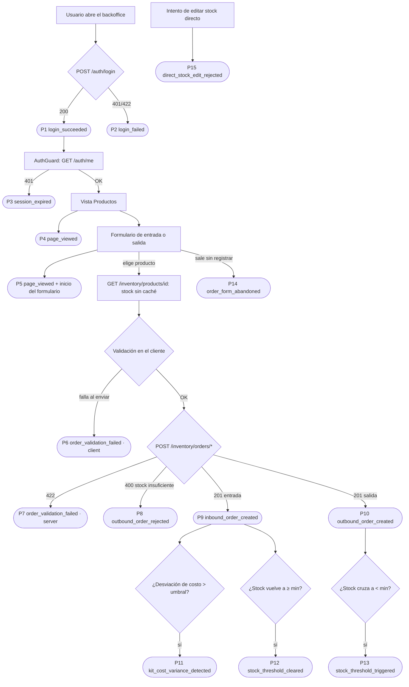

# Plan de Telemetría — Nexova

> **Respuesta al RFI del equipo de gestión:** sí, el sistema puede generar información de negocio accionable. Este documento define **qué** capturar, **por qué**, **con qué forma** y **con qué urgencia**, con el detalle suficiente para que otro desarrollador lo instrumente sin preguntar.
>
> | | |
> |---|---|
> | **Fuentes de verdad** | [`nexova-BRIEFING.es.md`](../../nexova-BRIEFING.es.md) (métricas obligatorias, entidades, restricciones) · [`CONTEXT.md`](../../CONTEXT.md) |
> | **Esquemas** | [`event-schemas.json`](./event-schemas.json): JSON Schema draft-07, generado y validado por [`tools/build_schemas.py`](./tools/build_schemas.py) |
> | **Envelope** | v1.0.0 · todos los `event_type` en `schemaVersion` 1.0.0 |
> | **Catálogo** | **30 eventos**: **5 obligatorios** (BRIEFING §3) + **25 oportunidades identificadas** |
> | **Categorías** | inventario (10) · autenticación (6) · rendimiento (3) · errores (3) · navegación (4) · proveedores (2) · comercial (1) · observabilidad (1) |
> | **Entrega** | 7 por *stream* (≤ 1 min) · 23 por *batch* (3 horarios, 20 diarios) |

---

## Índice

1. [Alcance y punto de partida](#1-alcance-y-punto-de-partida)
2. [Fase 1 — Catálogo de oportunidades de datos](#2-fase-1--catálogo-de-oportunidades-de-datos)
3. [Prerrequisitos de instrumentación (brechas entre BRIEFING y código)](#3-prerrequisitos-de-instrumentación)
4. [Fase 2 — Event Envelope, taxonomía, allowlists y PII](#4-fase-2--event-envelope-taxonomía-allowlists-y-pii)
5. [Fase 3 — Estrategia de entrega: stream vs. batch, throttle y debounce](#5-fase-3--estrategia-de-entrega)
6. [Riesgos y exclusiones](#6-riesgos-y-exclusiones)
7. [Guía de implementación y verificación](#7-guía-de-implementación-y-verificación)
8. [Verificación frente a la rúbrica](#8-verificación-frente-a-la-rúbrica)
9. [Almacenamiento: `telemetry_events` en Supabase](#9-almacenamiento-telemetry_events-en-supabase)
- [Anexo A — Especificación por evento (generada)](#anexo-a--especificación-por-evento)

---

## 1. Alcance y punto de partida

### 1.1 Qué cubre este plan

Todo lo que una persona o un proceso interno toca en la aplicación:

| Superficie | Componentes |
|---|---|
| **Backend** (FastAPI) | `services/api`: autenticación JWT, usuarios y perfiles, inventario (productos y órdenes), directorio de proveedores, dominios de RR. HH., middleware de timing, caché de lecturas |
| **Backoffice** (Next.js) | `uis/backoffice`: login, registro, perfil, activos/productos, formularios de entrada y salida, historial de órdenes, proveedores |
| **Website** (Next.js) | `uis/website`: landing corporativa y formulario de contacto |
| **Procesos** | jobs programados (foto diaria de stock) y los propios emisores de telemetría |

Las rutas de código citadas corresponden al estado de la rama `feature/caching-optimisation` (PR #12), que es la versión más reciente del sistema.

### 1.2 Qué **no** es este plan

- No es código: no se instrumenta nada todavía.
- El almacenamiento (tabla `telemetry_events` en Supabase y endpoint de ingesta) se implementó en el proyecto *Almacenamiento*: ver §9.

### 1.3 Restricciones del BRIEFING que gobiernan todo el diseño

| # | Restricción (BRIEFING §3 y §6) | Cómo se aplica |
|---|---|---|
| R1 | Montos en la moneda de la oficina (`EUR` Valencia, `USD` Miami), **sin convertir** | `currency` es obligatoria en todo evento con montos. El esquema **rechaza** `valencia`+`USD` y `miami`+`EUR`. El baseline de `kit_cost_variance_detected` sólo compara órdenes de la misma moneda |
| R2 | El stock nunca se modifica directamente: sólo con `InboundOrder` u `OutboundOrder` trazables | Los eventos de stock se emiten **después del commit** de una orden. Los intentos directos generan `direct_stock_edit_rejected` |
| R3 | Idioma de la UI ≠ oficina | `ui_locale` (`es`/`en`) y `office` (`valencia`/`miami`) son campos distintos y nunca se derivan uno del otro |
| R4 | Sin nombres de candidatos, clientes ni consultores en `properties` | Los destinatarios se representan sólo por `recipient_type`; las personas, por UUID interno o hash. Ver la política PII (§4.5) |
| R5 | Campos mínimos de inventario: `office`, `product_id`, `product_category`, `programme_id`, `quantity`, `currency` | **Obligatorios** en los 5 eventos del BRIEFING y en todos los de inventario que describen un Product (verificado automáticamente por el generador) |
| R6 | Agregables por oficina y por programa | `office` y `programme_id` son dimensiones de primer nivel, nunca texto libre (enum y slug validados) |

---

## 2. Fase 1 — Catálogo de oportunidades de datos

### 2.1 Métricas obligatorias (piso del plan, BRIEFING §3)

Las cinco métricas y sus hipótesis y decisiones se copian **literalmente** del BRIEFING. La columna *Precisión de instrumentación* es la aportación de este plan.

| `event_type` | Se dispara cuando… (BRIEFING) | Precisión de instrumentación | Entrega |
|---|---|---|---|
| `inbound_order_created` | Llega un nuevo lote de material desde un proveedor | Tras el **commit** de `POST /inventory/orders/inbound` (201). Incluye `unit_cost`, `total_cost` y `supplier_id` para responder *"con qué costo"* | batch diario |
| `outbound_order_created` | Se entrega un kit o certificado a un cliente, candidato, consultor o agente | Tras el **commit** de `POST /inventory/orders/outbound` (201). Destinatario sólo como `recipient_type` | batch diario |
| `stock_threshold_triggered` | El stock cae por debajo del mínimo configurado | Sólo en el **cruce** (`stock_before >= min_stock` y `stock_after < min_stock`), con histéresis: no se repite hasta que `stock_threshold_cleared` cierra el episodio | **stream** |
| `direct_stock_edit_rejected` | Un usuario intenta modificar el stock fuera de una orden y el sistema lo rechaza | Dos canales definidos (§3.3): escritura en `/inventory/products/{product_id}/stock` → 405, o clave de stock en el payload de un Product → 422 | **stream** |
| `kit_cost_variance_detected` | El costo unitario varía más de un umbral (ej. 10 %) respecto al histórico del mismo material y proveedor | Baseline = media de las últimas 5 entradas (mínimo 3) del mismo `product_id`+`supplier_id`+`currency` en 365 días. `threshold_pct` configurable, 10 por defecto | **stream** |

**Frase de la regla de oro para cada métrica obligatoria** (hipótesis y decisión textuales del BRIEFING):

| `event_type` | Capturamos `[event_type]` porque necesitamos saber `[hipótesis]`, lo que nos permite `[decisión]` |
|---|---|
| `inbound_order_created` | …porque necesitamos saber **cuánto material se produce/compra, para qué programa y con qué costo**, lo que nos permite **planificar la producción de material según demanda esperada de matrículas (Elena)**. |
| `outbound_order_created` | …porque necesitamos saber **qué programas consumen más material y a qué ritmo**, lo que nos permite **anticipar necesidades de reposición antes de una ola grande de matrículas (Elena)**. |
| `stock_threshold_triggered` | …porque necesitamos saber **con qué frecuencia un programa se queda sin material disponible**, lo que nos permite **ajustar el umbral mínimo o acelerar la reimpresión/reproducción de ese material**. |
| `direct_stock_edit_rejected` | …porque necesitamos saber **si el personal intenta saltarse el control de trazabilidad del material**, lo que nos permite **reforzar capacitación o permisos en la oficina donde esto ocurre con más frecuencia (Patricia)**. |
| `kit_cost_variance_detected` | …porque necesitamos saber **cuándo un proveedor de material sube precios de forma anómala**, lo que nos permite **alertar a Elena y a Laura para renegociar o buscar proveedor alterno**. |

### 2.2 Flujo de gestión de inventario y puntos de instrumentación

Recorrido desde que un usuario entra al backoffice hasta que completa (o no) una orden. Cada punto numerado **P*n*** es un punto de instrumentación.



| Punto | Evento | Dónde se instrumenta (código actual) | Pregunta que responde |
|---|---|---|---|
| P1 | `login_succeeded` | `services/api/src/api/auth/router.py` → `login` | ¿Quién usa el sistema y cuándo? |
| P2 | `login_failed` | mismo handler, ramas de error | ¿Cuántos intentos fallidos al día? ¿Hay fuerza bruta? |
| P3 | `session_expired` | `uis/backoffice/src/lib/auth.ts` → `expireSession()` | ¿La caducidad interrumpe trabajo? |
| P4, P5 | `page_viewed` | layout raíz del backoffice (`usePathname`) | ¿Qué secciones se usan? |
| P6 | `order_validation_failed` (`client`) | `components/talent-order-form.tsx` → `handleSubmit` | ¿Qué campos fallan antes de enviar? |
| P7 | `order_validation_failed` (`server`) | handler de `RequestValidationError` (a crear) en `main.py` | ¿Qué productos acumulan más errores de validación? |
| P8 | `outbound_order_rejected` | `inventory/router.py` → `create_outbound_order`, rama `ValueError` | ¿Cuánta demanda no se pudo atender? |
| P9 | `inbound_order_created` ★ | `inventory/service.py` → `create_entry`, tras `commit()` | ¿Cuánto material entra y a qué costo? |
| P10 | `outbound_order_created` ★ | `inventory/service.py` → `create_exit`, tras `commit()` | ¿Qué programas consumen y a qué ritmo? |
| P11 | `kit_cost_variance_detected` ★ | tras P9, en el servicio | ¿Un proveedor subió precios? |
| P12 | `stock_threshold_cleared` | tras P9, en el servicio | ¿Cuánto tarda la reposición? |
| P13 | `stock_threshold_triggered` ★ | tras P10, en el servicio | ¿Cuándo y cuánto nos quedamos sin material? |
| P14 | `order_form_abandoned` | `talent-order-form.tsx`, al desmontar o en `pagehide` | ¿Dónde se abandonan las órdenes? |
| P15 | `direct_stock_edit_rejected` ★ | nuevos guards del API (§3.3) | ¿Se intenta saltarse la trazabilidad? |

★ = métrica obligatoria del BRIEFING. El flujo tiene **15 puntos de instrumentación** (el mínimo pedido es 5), incluidos los tres exigidos: intento directo de modificar stock (P15), validaciones fallidas (P6, P7) y activación de umbral mínimo (P13).

### 2.3 Respuesta a las preguntas del tech lead

| Pregunta | Evento(s) | Cómo se responde |
|---|---|---|
| ¿Cuántas órdenes de salida se registran por día? | `outbound_order_created` | `count(*)` por día (en la zona horaria de la oficina) × `office` × `programme_id` |
| ¿Qué productos acumulan más errores de validación? | `order_validation_failed`, `outbound_order_rejected` | `count(*)` por `product_id` e `invalid_fields` |
| ¿Hay usuarios intentando modificar el stock directamente? | `direct_stock_edit_rejected` | `count(*)` por `office`, `userId` y `attempt_channel` |
| ¿Cuándo se disparan más las alertas de stock mínimo? | `stock_threshold_triggered`, `stock_threshold_cleared` | Distribución por hora y día de la semana × `programme_id`; duración de episodios |
| ¿Cuántos logins fallidos hay por día? | `login_failed` | `count(*)` por día y `failure_reason`; picos por `account_key_hash` |
| ¿Qué secciones visitan más los operadores? | `page_viewed` | `count(*)` y usuarios únicos por `route` |
| ¿Hay flujos que se abandonan a la mitad? | `order_form_abandoned` ÷ `page_viewed` del formulario | Tasa de abandono por `order_type` y `step_reached` |

### 2.4 Catálogo completo (30 eventos)

**Clasificación:** `obligatorio` = viene del BRIEFING · `identificado` = propuesto en este plan. Cada fila completa la regla de oro. El detalle de propiedades está en el [Anexo A](#anexo-a--especificación-por-evento).

| # | `event_type` | Origen | Categoría | Capturamos… porque necesitamos saber… lo que nos permite… | Entrega |
|---|---|---|---|---|---|
| 1 | `inbound_order_created` | **obligatorio** | inventario | …cuánto material se produce/compra, para qué programa y con qué costo → planificar la producción según la demanda de matrículas (Elena) | batch diario |
| 2 | `outbound_order_created` | **obligatorio** | inventario | …qué programas consumen más material y a qué ritmo → anticipar la reposición antes de una ola de matrículas (Elena) | batch diario |
| 3 | `stock_threshold_triggered` | **obligatorio** | inventario | …con qué frecuencia un programa se queda sin material → ajustar el mínimo o acelerar la reimpresión | **stream** |
| 4 | `direct_stock_edit_rejected` | **obligatorio** | inventario | …si el personal intenta saltarse la trazabilidad → reforzar capacitación o permisos en esa oficina (Patricia) | **stream** |
| 5 | `kit_cost_variance_detected` | **obligatorio** | inventario | …cuándo un proveedor sube precios de forma anómala → alertar a Elena y Laura para renegociar | **stream** |
| 6 | `outbound_order_rejected` | identificado | inventario | …cuánta demanda no se pudo entregar (invisible en las salidas exitosas) → subir mínimos o adelantar reposición | batch diario |
| 7 | `order_validation_failed` | identificado | inventario | …qué productos y campos acumulan errores de validación → corregir el formulario o capacitar | batch diario |
| 8 | `product_created` | identificado | inventario | …cómo crece el catálogo por programa y oficina → auditar duplicados y cobertura por oficina | batch diario |
| 9 | `stock_threshold_cleared` | identificado | inventario | …cuánto tarda la reposición real → exigir plazos a proveedores lentos o subir mínimos | batch diario |
| 10 | `inventory_snapshot_recorded` | identificado | inventario | …la evolución del stock sin recalcular el ledger → reporte semanal de Laura y detección de material inmovilizado | batch diario |
| 11 | `order_form_abandoned` | identificado | navegación | …si hay fricción que hace abandonar las órdenes → rediseñar el paso más abandonado | batch diario |
| 12 | `supplier_rate_updated` | identificado | proveedores | …cómo evolucionan los costos fijos de proveedores → calendarizar renegociaciones | batch diario |
| 13 | `supplier_status_changed` | identificado | proveedores | …si una categoría queda sin proveedor activo en una oficina → buscar alternativa antes del corte | batch diario |
| 14 | `login_succeeded` | identificado | autenticación | …cuántas personas usan el backoffice, con qué rol y en qué horario → dimensionar capacitación y desactivar cuentas inactivas | batch diario |
| 15 | `login_failed` | identificado | autenticación | …cuántos intentos fallidos hay y si hay fuerza bruta → bloquear cuenta o IP, o exigir MFA | **stream** |
| 16 | `session_expired` | identificado | autenticación | …si la caducidad del token interrumpe trabajo real → ajustar el TTL o implementar refresh token | batch diario |
| 17 | `user_logged_out` | identificado | autenticación | …cuánto duran las sesiones reales → fijar el TTL según el uso | batch diario |
| 18 | `user_registered` | identificado | autenticación | …si el registro abierto crea cuentas inesperadas → cerrar el autoregistro (Patricia) | batch diario |
| 19 | `access_denied` | identificado | autenticación | …si hay exploración de recursos ajenos o permisos mal definidos → corregir roles o investigar la cuenta | batch diario |
| 20 | `api_latency_recorded` | identificado | rendimiento | …qué endpoints se degradan y si la caché sigue acertando → rollback, escalar o cachear | **stream** |
| 21 | `page_load_recorded` | identificado | rendimiento | …cómo perciben la velocidad los usuarios reales → priorizar optimizaciones y bloquear releases lentas | batch diario |
| 22 | `db_query_slow_detected` | identificado | rendimiento | …qué consultas explican la latencia → índices, reescrituras o caché | batch horario |
| 23 | `api_error_returned` | identificado | errores | …qué fallos de servidor sufren los usuarios → rollback o hotfix | **stream** |
| 24 | `frontend_error_captured` | identificado | errores | …si hay vistas rotas que el backend no ve → hotfix del frontend | **stream** |
| 25 | `api_request_failed` | identificado | errores | …qué fallos ve el cliente y el servidor no registra → investigar proxy, CORS o red | batch horario |
| 26 | `page_viewed` | identificado | navegación | …qué secciones se usan y cómo se llega a ellas → priorizar o retirar secciones | batch diario |
| 27 | `list_filter_applied` | identificado | navegación | …qué filtros se necesitan de verdad → añadir filtros (oficina, programa) y decidir caché o índice | batch diario |
| 28 | `contact_section_viewed` | identificado | navegación | …qué proporción de visitantes llega al formulario de contacto → reubicar la llamada a la acción | batch diario |
| 29 | `contact_request_submitted` | identificado | comercial | …qué servicios generan demanda y desde qué país → asignar consultores y presupuesto de marketing | batch diario |
| 30 | `telemetry_events_dropped` | identificado | observabilidad | …si la instrumentación pierde datos o viola el allowlist → corregirla antes de que los reportes se basen en datos incompletos | batch horario |

Total: **5 obligatorios + 25 identificados = 30**, la misma cifra que declara `event-schemas.json` en `x-event-count`.

Puntos descartados porque **no completaban la regla de oro**: ver §6.1.

---

## 3. Prerrequisitos de instrumentación

> ⚠️ **Sin esta sección el plan no se puede instrumentar.** El BRIEFING describe el inventario de Nexova como **material de formación y kits** en las oficinas de **Valencia y Miami**. El código implementado en hitos anteriores modela un inventario de **talento** (`TalentAsset`) en **Chile y Argentina**. Este plan sigue al BRIEFING (es la fuente que se evalúa y la que usarán Elena y Laura), así que el modelo debe alinearse **antes** de instrumentar.

### 3.1 Equivalencias entre el BRIEFING y el código actual

| BRIEFING | Código actual | Brecha a cerrar |
|---|---|---|
| `Product` | `TalentAsset` (`talent_assets`) | Renombrar o mapear. Faltan `product_category` (enum de 3 valores), `programme_id` (slug), `office` (`valencia`/`miami`; hoy `country` = Chile/Argentina) y `min_stock` (entero ≥ 0 por Product y oficina) |
| `InboundOrder` | `TalentEntry` (`talent_entries`) | Faltan `unit_cost` (decimal ≥ 0, en la moneda de la oficina) y `supplier_id` |
| `OutboundOrder` | `TalentExit` (`talent_exits`) | Falta `recipient_type` (`client`/`candidate`/`consultant`/`support_agent`) |
| `office` | `country` | Valores distintos. El directorio de proveedores ya usa Spain/USA ↔ EUR/USD, que encaja con Valencia/Miami |
| `currency` | — | Se deriva de `office` (`valencia`→`EUR`, `miami`→`USD`); no hace falta guardarla en el Product |
| `programme` | — | Nuevo. Slugs como `ventas-b2b`, `liderazgo-basico`, `soporte-onboarding` |
| Mínimo configurado | Heurística de UI `stockLevel()` (≤ 5 = "Stock bajo") en `uis/backoffice/src/lib/inventory.ts` | Sustituir por el `min_stock` real del Product |

### 3.2 Correlación entre frontend y backend (lo que hay que añadir)

| Cambio | Dónde | Detalle |
|---|---|---|
| `X-Session-Id` | `uis/backoffice/src/lib/api.ts` → `request()` | Enviar el `sessionId` de telemetría en cada llamada |
| `X-Request-Id` | mismo lugar | UUID v4 nuevo por llamada. El backend lo acepta si es un UUID válido y, si no, genera uno. Se devuelve en la respuesta y se escribe en el log `api.timing` |
| `request.state` | middleware de `main.py` | Guardar `request_id`, `session_id` y `user_id` para que los emisores del backend los lean |

### 3.3 Qué cuenta como "intento directo de modificar stock"

Hoy **no existe** forma de editar stock directamente, y eso es correcto. Pero un `current_stock` enviado en el body de `POST /inventory/products` se **ignora en silencio** (Pydantic con `extra="ignore"`), así que el rechazo que pide el BRIEFING no se puede medir. Para que el evento exista:

1. Los esquemas de entrada de Product pasan a `extra="forbid"`, y las claves `current_stock`, `stock` y `quantity` en `POST /inventory/products` o `PUT`/`PATCH /inventory/products/{product_id}` → **422** + `direct_stock_edit_rejected` (`attempt_channel=stock_field_in_product_payload`).
2. Se declara la ruta `/inventory/products/{product_id}/stock` sólo para `PUT`/`PATCH`/`DELETE`, y siempre responde **405** (`Allow:` vacío) + `direct_stock_edit_rejected` (`attempt_channel=stock_endpoint_write`). Esto hace que el intento sea **detectable** en vez de un 404 genérico.
3. Si el `product_id` no existe, se responde 404 y **no** se emite el evento: sin Product no hay `office` ni `programme_id` que reportar.

### 3.4 Garantía de entrega de los eventos de negocio (outbox transaccional)

Los 5 eventos obligatorios y `stock_threshold_cleared` se escriben en una tabla `telemetry_outbox` **dentro de la misma transacción** que la orden. Un proceso los publica después y los marca como enviados. Así:

- Si la orden se confirma, el evento **existe sí o sí** (sin pérdidas aunque el colector esté caído).
- Si la orden falla, el evento **no existe** (sin falsos positivos).
- El `eventId` se genera al escribir en el outbox, y los reintentos de publicación reutilizan el mismo `eventId`: el almacenamiento deduplica por `eventId`.

El resto de eventos del backend se emiten *fire-and-forget* después de responder. Perderlos ocasionalmente no compromete ninguna decisión, y `telemetry_events_dropped` lo hace visible.

---

## 4. Fase 2 — Event Envelope, taxonomía, allowlists y PII

### 4.1 Event Envelope v1.0.0

Todo evento, sin excepción, tiene esta forma (validada por `definitions.envelope` en `event-schemas.json`, con `additionalProperties: false`):

```json
{
  "eventId": "3b241101-e2bb-4255-8caf-4136c566a962",
  "timestamp": "2026-11-15T10:42:17.123Z",
  "sessionId": "6f1d2c3b-4a5e-4f60-8b7a-9c8d7e6f5a4b",
  "userId": "2c5ea4c0-4067-4a9b-8f3e-1d2c3b4a5f6e",
  "event_type": "outbound_order_created",
  "schemaVersion": "1.0.0",
  "requestId": "8e7d6c5b-4a39-4b28-9c17-0f1e2d3c4b5a",
  "context": { "source": "backend_api", "environment": "production", "appVersion": "e272808" },
  "properties": { "...": "allowlist del event_type" }
}
```

| Campo | Tipo | Obligatorio | Regla exacta |
|---|---|---|---|
| `eventId` | string UUID v4 | sí | Se genera **una vez por ocurrencia**, en el emisor (en el outbox para los eventos de negocio). Es la clave de deduplicación: un reintento reutiliza el mismo valor |
| `timestamp` | string ISO 8601 | sí | **UTC con milisegundos y `Z`** (`YYYY-MM-DDTHH:mm:ss.sssZ`). Es el momento de la *ocurrencia*: en el backend, tras el commit. El colector añade aparte `receivedAt` para detectar desfase de reloj; ese campo no forma parte del envelope |
| `sessionId` | string UUID \| null | sí (la clave) | Lo genera el frontend al primer evento de la pestaña y lo guarda en `sessionStorage` (`nexova.telemetry.sessionId`). Rota tras 30 min de inactividad. Viaja como `X-Session-Id`. Es `null` en jobs y eventos de sistema |
| `userId` | string UUID \| null | sí (la clave) | `users.id` de TinyDB (UUID interno). Es `null` si no hay usuario autenticado. **Nunca un email.** Los eventos marcados como *obligatorios (no null)* en el Anexo A lo exigen |
| `event_type` | string | sí | `entidad_acción` en snake_case (§4.2). Regex: `^[a-z]+(_[a-z]+)+$` |
| `schemaVersion` | string SemVer | sí | Versión del esquema de **ese** `event_type` (todos empiezan en `1.0.0`). Política en §4.4 |
| `requestId` | string UUID v4 | sí | Correlación frontend–backend–logs: viaja como `X-Request-Id` y aparece en el log `api.timing` y en los 5xx. En jobs es el id de la ejecución; en agregados, el id de la ventana |
| `context` | object | sí | `source` (`frontend_backoffice`, `frontend_website`, `backend_api`, `backend_job`), `environment` (`development`, `staging`, `production`) y `appVersion` (SHA corto de git). Metadatos técnicos, nunca de negocio |
| `properties` | object | sí | Payload del evento. **Sólo** las claves del allowlist de su `event_type` |

> **¿Por qué `context` si la rúbrica no lo pide?** Sin `source` no se puede distinguir un `page_viewed` del website de uno del backoffice. Sin `appVersion` no se puede responder *"¿este error empezó con el último despliegue?"*. Sin `environment`, los datos de desarrollo contaminan los reportes de Laura. Va separado de `properties` para que el allowlist de negocio siga siendo pequeño y auditable.

### 4.2 Taxonomía `entidad_acción`

- **Entidad** en singular y en el idioma del código (inglés): `inbound_order`, `stock_threshold`, `login`, `page`, `api_latency`…
- **Acción en participio pasado**, porque un evento describe algo que **ya ocurrió**. Vocabulario cerrado:

| Verbo | Significado | Eventos |
|---|---|---|
| `created` | Una entidad nueva se persistió | `inbound_order_created`, `outbound_order_created`, `product_created` |
| `rejected` / `denied` / `failed` | El sistema rechazó una operación del usuario | `direct_stock_edit_rejected`, `outbound_order_rejected`, `access_denied`, `login_failed`, `order_validation_failed`, `api_request_failed` |
| `triggered` / `cleared` | Una condición de umbral se abrió o se cerró | `stock_threshold_triggered`, `stock_threshold_cleared` |
| `detected` | El sistema infirió una anomalía | `kit_cost_variance_detected`, `db_query_slow_detected` |
| `recorded` | Una medición periódica o agregada | `api_latency_recorded`, `page_load_recorded`, `inventory_snapshot_recorded` |
| `updated` / `changed` | Mutación de un atributo (`changed` para estados discretos) | `supplier_rate_updated`, `supplier_status_changed` |
| `succeeded` / `expired` / `logged_out` / `registered` | Ciclo de vida de la sesión o la cuenta | `login_succeeded`, `session_expired`, `user_logged_out`, `user_registered` |
| `viewed` / `applied` / `submitted` / `abandoned` | Interacción del usuario | `page_viewed`, `contact_section_viewed`, `list_filter_applied`, `contact_request_submitted`, `order_form_abandoned` |
| `returned` / `captured` / `dropped` | Errores y salud de la propia telemetría | `api_error_returned`, `frontend_error_captured`, `telemetry_events_dropped` |

Un evento nuevo debe reutilizar uno de estos verbos. Añadir un verbo requiere actualizar esta tabla en el mismo PR.

### 4.3 Allowlist de propiedades: cómo se aplica

1. **La fuente de verdad es `event-schemas.json`.** Cada `event_type` declara `properties` con `additionalProperties: false`, y la lista legible está en la clave `x-allowlist`. Los `enum` también son allowlists: un valor nuevo (otra oficina, otra ruta) exige subir la versión del esquema.
2. **Los emisores validan antes de enviar** (SDK del frontend y emisor del backend), cargando el JSON en build o arranque.
3. **Fail-closed:** un evento que no valida **no se envía, ni recortado**.
   - En `development` y `test` el emisor lanza una excepción (el test falla).
   - En `production` se descarta y se cuenta en `telemetry_events_dropped` (`reason=schema_violation`, con los **nombres** de las claves rechazadas en `rejected_keys`).
   - **¿Por qué no recortar la clave y enviar el resto?** Una clave inesperada indica un bug de instrumentación que podría estar filtrando PII en otro campo. Es preferible perder el evento y verlo en el contador que enviarlo a medias.
4. **CI:** `build_schemas.py` comprueba para **cada** evento que el ejemplo válido pasa y que añadirle `candidate_name` **falla** (prueba negativa del allowlist).

### 4.4 Versionado de esquemas

| Cambio | Versión | Ejemplo |
|---|---|---|
| Añadir una propiedad **opcional** o un valor de enum | *minor* (`1.1.0`) | nueva ruta en `FRONTEND_ROUTES` |
| Cambiar el texto de una descripción | *patch* (`1.0.1`) | — |
| Renombrar o quitar una propiedad, cambiar su tipo o volver obligatoria una opcional | *major* (`2.0.0`) | `quantity` pasa a decimal |

Durante una migración *major*, el emisor publica **ambas** versiones del evento durante un sprint, para no romper el dashboard de Elena ni el reporte de Laura (BRIEFING §4: *"alguien más dependerá de ellas sin poder preguntarte"*).

### 4.5 Datos sensibles y PII

**Principio:** Nexova es una consultora de RR. HH. y casi todo lo que maneja se refiere a personas. La telemetría describe **operaciones**, no **personas**.

| Dato | ¿Se emite? | Tratamiento |
|---|---|---|
| Nombre o email de candidatos, clientes, consultores o agentes | **Nunca** (BRIEFING §3) | Sólo `recipient_type` |
| Email del usuario que inicia sesión | **Nunca en claro** | `login_failed.account_key_hash` = HMAC-SHA256(email en minúsculas y sin espacios, *pepper* del gestor de secretos), primeros 16 hex. No es reversible sin el *pepper* y permite contar fallos por cuenta |
| IP del cliente | **Nunca en claro** | `client_ip_hash` = HMAC-SHA256(IP, sal **diaria**), 16 hex. La sal rota a las 00:00 UTC y se destruye a las 48 h, así que no se puede seguir a nadie entre días |
| Identificador del usuario | Sí, como UUID interno (`userId`) | Es un seudónimo: no contiene nombre ni email. Se necesita para la trazabilidad que exige el BRIEFING §6 y para agregar `direct_stock_edit_rejected` por persona |
| Notas libres de las órdenes (`notes`) | **Nunca** | Texto libre que puede contener nombres |
| Valores de formularios (cantidad, notas, mensaje de contacto) | **Nunca** | Sólo nombres de campos (`invalid_fields`), booleanos (`has_company`) o tramos (`message_length_bucket`) |
| Mensajes de error | Sí, **sanitizados** | Frontend: truncado a 200 caracteres, emails → `<email>`, UUIDs → `<uuid>`, números → `<n>`. Backend: sólo la clase de excepción y una huella, nunca el mensaje |
| URLs | Sí, como **plantilla** | `/inventory/products/{product_id}`, sin IDs reales ni query string; `route` es un enum cerrado |
| User-agent | **No** | Sólo `device_class` por ancho de viewport (evita el *fingerprinting*) |
| SQL | Sólo la **huella** de la consulta normalizada | Los parámetros nunca salen del proceso |

**Base legal y consentimiento.** Valencia está en la UE, así que aplica el RGPD.
- **Backoffice:** son usuarios internos y se aplica interés legítimo (seguridad y operación), informado en la política interna.
- **Website:** los eventos `page_viewed`, `page_load_recorded`, `contact_section_viewed` y `contact_request_submitted` **sólo se emiten tras consentimiento de analítica**. Sin consentimiento no se genera `sessionId` en el website.

**Retención:** eventos de autenticación, 90 días · errores y rendimiento, 30 días · negocio e inventario, 25 meses (para comparar interanualmente) · sales diarias de IP, 48 h.

La columna *PII / sanitización* de cada evento en el Anexo A concreta lo anterior.

---

## 5. Fase 3 — Estrategia de entrega

### 5.1 Criterio de decisión

> **Stream** sólo si la decisión que alimenta pierde valor en minutos: hay un daño en curso (ataque, caída, error en producción) o una acción con plazo (reimprimir material, frenar un pedido caro). **Todo lo demás va en batch**, que es más barato, más simple y suficiente para decisiones que se toman en días o semanas.

| Modo | Nivel de servicio | Uso |
|---|---|---|
| **stream** | Del evento al consumidor en ≤ 1 min, con reglas de alerta | 7 eventos |
| **batch horario** | Cargado al almacén cada hora | 3 eventos de diagnóstico técnico |
| **batch diario** | Cargado a las 02:00 de la oficina (o al cierre del día) | 20 eventos de negocio, adopción y producto |

### 5.2 Decisión por evento (resumen; la justificación completa está en el Anexo A)

| Evento | Modo | Por qué (urgencia de la decisión) | Alerta |
|---|---|---|---|
| `stock_threshold_triggered` | **stream** | Reimprimir o reproducir tarda días; enterarse mañana quita un día de margen antes de una matrícula sin kits | Elena + responsable de la oficina |
| `direct_stock_edit_rejected` | **stream** | El agregado semanal sirve a Patricia, pero un intento puede ser un script o una cuenta comprometida, y eso se detecta en minutos | ≥ 3 del mismo `userId` en 10 min |
| `kit_cost_variance_detected` | **stream** | El BRIEFING pide *alertar*: el valor está en frenar el pago o el siguiente pedido | `direction=increase` → Elena + Laura |
| `login_failed` | **stream** | La fuerza bruta se frena en minutos o no se frena | ≥ 10 por `account_key_hash` o `client_ip_hash` en 15 min |
| `api_latency_recorded` | **stream** | Una degradación afecta a todos mientras dura | p95 > 500 ms en 3 ventanas seguidas |
| `api_error_returned` | **stream** | Un 5xx es una funcionalidad rota en producción | fingerprint nuevo o > 5 en 5 min |
| `frontend_error_captured` | **stream** | Puede romper el registro de entregas sin que el backend lo vea | fingerprint nuevo en ≥ 3 sesiones en 10 min |
| `db_query_slow_detected`, `api_request_failed`, `telemetry_events_dropped` | batch **horario** | Diagnóstico: hay que verlo el mismo día, pero la alerta ya la da otro evento (latencia o 5xx) | — |
| `inbound_order_created`, `outbound_order_created` | batch diario | Planificación de producción y reposición, con horizonte de semanas. Lo urgente está separado en `stock_threshold_triggered` y `kit_cost_variance_detected` | — |
| Resto (18 eventos) | batch diario | Decisiones de sprint, de configuración o de política | — |

**Decisión deliberada:** las órdenes (`*_order_created`) **no** van por stream aunque sean el corazón del inventario. La decisión de Elena (planificar producción) no cambia por ver una entrega 30 s antes. Lo que sí es urgente se derivó en eventos propios que sí van por stream. Así el stream queda pequeño y cada alerta significa algo.

### 5.3 Throttle y debounce para eventos de alta frecuencia

| Evento | Riesgo de volumen | Estrategia | Parámetros |
|---|---|---|---|
| `api_latency_recorded` | Un evento por petición generaría miles por minuto | **Agregación por ventana fija** en el middleware: p50, p95, max, conteo y aciertos de caché | 60 s · 1 evento por (ruta, método, clase de status). Se excluye `/health` (healthcheck cada 10 s) |
| `page_viewed` | Doble render y `router.replace` | **Deduplicación** | Misma ruta en < 2 s → se ignora |
| `list_filter_applied` | Cambios rápidos de filtros | **Debounce** | 1 s sin cambios → se emite el estado final |
| `order_validation_failed` (cliente) | Validación en cada pulsación | Sólo se emite **al intentar enviar**, nunca al teclear | — |
| `frontend_error_captured` | Bucles de render que lanzan el mismo error | **Throttle** por fingerprint y por sesión | 1 cada 60 s por fingerprint · máximo 20 por sesión |
| `api_error_returned` | Una caída genera cientos de 5xx iguales | **Throttle con conteo** | 1 inmediato + 1 cada 10 s por `error_fingerprint`, con `occurrence_count` |
| `login_failed` | Ataque automatizado | **Tope con conteo** | 60 por minuto por `client_ip_hash`; el excedente va en `suppressed_count` |
| `db_query_slow_detected` | Una consulta lenta en un endpoint caliente | **Throttle** por huella | 1 cada 60 s por `query_fingerprint` |
| `stock_threshold_triggered` | Cada salida mientras el stock sigue bajo el mínimo | **Histéresis** (*edge-trigger*) | 1 por episodio; se rearma con `stock_threshold_cleared` |
| `page_load_recorded` | Volumen del website público | **Muestreo** por sesión | 100 % backoffice · 25 % website |
| `telemetry_events_dropped` | Cada descarte | **Agregación** | 60 s por (emisor, motivo, event_type) |

### 5.4 Transporte (contrato para el proyecto de *Captura*)

- **Frontend:**
  - Buffer en memoria que se envía en lote a `POST /telemetry/events` cuando llega a 20 eventos, cada 10 s o en `pagehide` (`navigator.sendBeacon`).
  - Los eventos *stream* del frontend (`frontend_error_captured`) se envían de inmediato.
  - Si el envío falla, se reintenta hasta 3 veces con *backoff*; después se descarta y se cuenta en `telemetry_events_dropped`.
- **Backend:**
  - Eventos de negocio: por el outbox transaccional (§3.4).
  - Resto: un emisor asíncrono no bloqueante, que nunca retrasa la respuesta HTTP.
- **Colector:**
  - Valida contra `event-schemas.json`.
  - Deduplica por `eventId`.
  - Añade `receivedAt`.
  - Enruta a stream o batch según `x-delivery.mode`.

---

## 6. Riesgos y exclusiones

### 6.1 Eventos considerados y descartados

| Candidato | Por qué se descartó |
|---|---|
| `stock_depleted` (stock = 0) | Redundante: es `stock_threshold_triggered` con `quantity = 0`. Un segundo evento duplicaría las alertas del mismo episodio |
| `inventory_product_viewed` (detalle de producto) | En la UI no existe una vista de detalle. `GET /inventory/products/{id}` lo llama el formulario de órdenes, que ya se mide con `page_viewed` y `order_form_abandoned`. No había una decisión que completara la regla de oro |
| `api_request_completed` (uno por petición) | Miles de eventos al día sin una decisión que los necesite uno a uno. `api_latency_recorded` responde lo mismo agregado por minuto |
| `data_load_retried` (botón *Reintentar*) | La hipótesis (*"¿los usuarios sufren fallos de carga?"*) ya la responde `api_request_failed`. Que el usuario reintente no cambia la decisión |
| `nav_link_clicked` | `page_viewed.referrer_route` ya da el camino. Medir el clic añade volumen sin una decisión nueva |
| `order_form_started` | Se obtiene de `page_viewed` sobre la ruta del formulario. Basta como denominador de la tasa de abandono |
| `cache_hit_recorded` (uno por acierto) | Un evento por lectura sería ruido. Los aciertos y fallos ya van agregados en `api_latency_recorded` |
| `profile_updated` | El perfil (nombre, teléfono, dirección) es PII y su cambio no alimenta ninguna decisión de negocio u operación |
| Eventos de los dominios `candidates`, `vacancies`, `interviews`… | Hoy son CRUD de prueba por usuario y contienen datos de candidatos. Se instrumentarán cuando el proceso de selección sea real y se acuerden las preguntas de negocio, con su propio análisis de PII |
| `health_check_recorded` | El healthcheck de Docker llama a `/health` cada 10 s. Medirlo sólo mide al propio Docker. Si el servicio cae, ya lo indica `api_latency_recorded` al dejar de llegar |

### 6.2 Datos que no se capturan, por privacidad o por costo

| Dato | Razón |
|---|---|
| Grabación de sesiones, mapas de calor y movimiento del ratón | Privacidad (pantallas con datos de candidatos) y costo, sin una decisión concreta |
| Contenido de formularios (notas, mensajes, nombres) | PII, prohibido por el BRIEFING §3 |
| IP y emails en claro | PII según el RGPD; se reemplazan por HMAC (§4.5) |
| Stack traces completos en la telemetría | Pueden incluir datos del request. Quedan en los logs, enlazados por `requestId` |
| Conversión de moneda | Prohibida por el BRIEFING §6. Se compara y agrega por moneda |
| Geolocalización precisa | Sin decisión que la necesite; la dimensión geográfica de negocio es `office` |

### 6.3 Riesgos y mitigaciones

| Riesgo | Impacto | Mitigación |
|---|---|---|
| **Brecha entre el modelo del BRIEFING y el código** (§3) | Sin `office`, `programme_id` o `unit_cost`, los eventos obligatorios no se pueden emitir válidos | Prerrequisito explícito. El esquema obliga los 6 campos, así que un emisor incompleto falla en CI, no en producción |
| **Doble conteo** por reintentos del cliente o del outbox | Inflaría las métricas de Elena y Laura | `eventId` estable y deduplicación en el colector; las órdenes llevan `order_id` |
| **Evento sin orden** (el emisor envía antes de que falle el commit) | Falsos positivos de stock | Outbox transaccional: sin commit no hay evento |
| **Fuga de PII** por un campo nuevo añadido sin revisar | Incidente RGPD | Allowlist con `additionalProperties: false`, *fail-closed* y prueba negativa en CI (§4.3) |
| **Ruido de alertas** (umbral mal calibrado) | Las personas dejan de mirar las alertas | Histéresis y umbrales configurables. Revisar la tasa de alertas tras 2 semanas y ajustar `min_stock` y `threshold_pct` (es justo la decisión que habilita el evento) |
| **Baseline de costo débil** (pocas órdenes por proveedor) | Desviaciones falsas | Exigir 3 o más órdenes en el baseline; sin historial no se emite |
| **Desfase de reloj** en el navegador | Orden temporal incorrecto | El colector registra `receivedAt`; para el negocio manda el `timestamp` del backend (tras el commit) |
| **Cardinalidad** (rutas con IDs, mensajes libres) | Almacenamiento caro y consultas lentas | Enums cerrados para rutas y endpoints, huellas en vez de texto |
| **Caché por proceso**: la API corre en un proceso y la agregación de latencia es por proceso | Si se escala a N procesos, habrá N eventos por ventana | Diseño aditivo: `request_count` se suma y los percentiles se recalculan en el almacén con pesos. Documentado para el proyecto de *Almacenamiento* |
| **Consentimiento en el website** | Sanción RGPD o ePrivacy | Sin consentimiento no hay `sessionId` ni eventos de analítica (§4.5) |
| **Uso indebido de `direct_stock_edit_rejected` para vigilar a personas** | Clima laboral, RGPD | La decisión del BRIEFING es por **oficina**. El desglose por `userId` sólo se usa en la alerta de seguridad, con acceso restringido a Patricia y al equipo técnico |

---

## 7. Guía de implementación y verificación

### 7.1 Orden sugerido

1. Prerrequisitos de modelo (§3.1) y guards de stock directo (§3.3).
2. Correlación: `X-Request-Id` y `X-Session-Id` (§3.2).
3. Emisor del backend con validación contra `event-schemas.json` + outbox (§3.4).
4. Los 5 eventos obligatorios (P9–P11, P13 y P15).
5. Eventos de autenticación y errores (stream) → rendimiento → navegación → resto.

### 7.2 Escenarios de verificación (encajan con los datos semilla del BRIEFING §5)

| Escenario | Acción | Evento esperado |
|---|---|---|
| Entrada normal | Inbound de 40 `kit-cert-ventas-b2b` en Valencia a 18,50 EUR | `inbound_order_created` (`currency=EUR`) |
| Desviación de costo | 6.ª inbound del mismo kit y proveedor a 21,40 EUR (baseline 18,60) | `kit_cost_variance_detected` (`variance_pct≈15.05`, `direction=increase`) |
| Umbral (caso 1) | `min_stock=5`; outbound que deja el stock de 6 en 4 | `stock_threshold_triggered` (`stock_before=6`, `quantity=4`) |
| Histéresis | Otra outbound que deja 4 en 3 | **Ningún** evento de umbral nuevo |
| Umbral (caso 2) | Laptop de onboarding en Miami, `min_stock=3`, salida que deja 3 en 2 | `stock_threshold_triggered` (`currency=USD`) |
| Cierre del episodio | Inbound que devuelve el kit a ≥ 5 | `stock_threshold_cleared` con `episode_duration_minutes` |
| Stock directo | `PATCH /inventory/products/{id}` con `{"current_stock": 30}` | 422 + `direct_stock_edit_rejected` |
| Fuga de PII | Emitir `outbound_order_created` con `recipient_name` | Evento **descartado** + `telemetry_events_dropped` (`schema_violation`, `rejected_keys=["recipient_name"]`) |

### 7.3 Regenerar y validar los esquemas

```bash
uv run --with jsonschema python docs/telemetry/tools/build_schemas.py          # regenera JSON + Anexo A y valida
uv run --with jsonschema python docs/telemetry/tools/build_schemas.py --check  # CI: falla si están desactualizados
```

El script valida el JSON Schema contra el metaesquema draft-07 y comprueba cada ejemplo. También verifica que se rechacen una clave fuera del allowlist, el par `office`/`currency` incoherente y un `timestamp` que no es ISO 8601. Por último, confirma que los 5 obligatorios exigen los 6 campos mínimos del BRIEFING.

---

## 8. Verificación frente a la rúbrica

- [x] **Métricas obligatorias** del BRIEFING presentes con sus nombres exactos y los 6 campos mínimos (§2.1, Anexo A §A.1–A.5; verificado por script).
- [x] **Cobertura técnica y de negocio amplia:** 30 eventos en 8 categorías, 25 de ellos identificados en este plan (§2.4).
- [x] **Cada evento tiene hipótesis y decisión** (regla de oro en §2.4 y en el Anexo A). Los que no la completaban se descartaron (§6.1).
- [x] **Envelope consistente** con `eventId`, `timestamp` ISO 8601, `sessionId`, `userId`, `event_type` (`entidad_acción`), `schemaVersion`, `requestId` y `properties` (§4.1). Lo impone `allOf: [envelope]` en cada esquema.
- [x] **Allowlist por evento** con `additionalProperties: false`, la clave `x-allowlist` y una prueba negativa en CI (§4.3).
- [x] **`event-schemas.json` válido y consistente:** se genera desde la misma fuente que el Anexo A y `--check` falla si divergen.
- [x] **Stream/batch justificado por urgencia** (§5.1–5.2 y en cada evento).
- [x] **PII identificada y sanitizada** (§4.5 y en cada evento).
- [x] **Riesgos y exclusiones con razones** (§6).
- [x] **Instrumentable sin aclaraciones:** dónde emitir (archivo y función), cuándo exactamente, prerrequisitos y escenarios de verificación (§2.2, §3, §7).

---

## 9. Almacenamiento: `telemetry_events` en Supabase

> Implementado en el proyecto *Almacenamiento*: migración `services/api/migrations/001_telemetry_events.sql` y endpoint `POST /telemetry/events` (`services/api/src/api/telemetry/`).

### 9.1 Tabla

| Columna | Tipo | Regla |
|---|---|---|
| `id` | `uuid` PK, default `gen_random_uuid()` | Identificador del registro (no confundir con `eventId`, que va en `tags._envelope`) |
| `timestamp` | `timestamptz` NOT NULL | `envelope.timestamp` (UTC, momento de la ocurrencia) |
| `service` | `text` NOT NULL | Derivado de `envelope.context.source`: `frontend_backoffice`→`backoffice`, `frontend_website`→`website`, `backend_api`→`api`, `backend_job`→`job` |
| `event_type` | `text` NOT NULL | `envelope.event_type`. CHECK con el regex `entidad_acción` |
| `level` | `text` default `'info'` | `error`: `api_error_returned`, `frontend_error_captured` · `warn`: rechazos, umbrales, anomalías y degradaciones (`direct_stock_edit_rejected`, `kit_cost_variance_detected`, `stock_threshold_triggered`, `outbound_order_rejected`, `order_validation_failed`, `login_failed`, `access_denied`, `api_request_failed`, `db_query_slow_detected`, `telemetry_events_dropped`, `session_expired`) · `info`: el resto. CHECK `info`/`warn`/`error` |
| `value` | `numeric` nullable | La propiedad numérica principal del evento (tabla 9.2); `NULL` si no aplica |
| `message` | `text` nullable | Resumen legible generado **sólo** con dimensiones del allowlist (`office`, `programme_id`, `currency`, `endpoint`…). Nunca texto libre ni PII |
| `tags` | `jsonb` default `'{}'` | `envelope.properties` **tal cual** (ya validadas contra el allowlist) + la clave reservada `_envelope` (9.3) |

**Índices:** `timestamp` (btree desc), `event_type` (btree) y `tags` (GIN, `jsonb_ops`: soporta `@>`, `?`, `?|`, `?&`).

**Inmutabilidad:** un trigger rechaza `UPDATE`, `DELETE` y `TRUNCATE` para todos los roles. `anon` y `authenticated` no tienen permisos, y RLS está activado sin políticas. El backend sólo hace `INSERT`.

### 9.2 Columna `value` por evento

| `event_type` | `value` = `properties.` |
|---|---|
| `inbound_order_created`, `outbound_order_created`, `outbound_order_rejected`, `direct_stock_edit_rejected`, `stock_threshold_triggered`, `inventory_snapshot_recorded` | `quantity` |
| `kit_cost_variance_detected` | `variance_pct` |
| `stock_threshold_cleared` | `episode_duration_minutes` |
| `supplier_rate_updated` | `change_pct` |
| `api_latency_recorded` | `p95_ms` |
| `page_load_recorded` | `lcp_ms` |
| `db_query_slow_detected`, `api_request_failed` | `duration_ms` |
| `api_error_returned` | `occurrence_count` |
| `telemetry_events_dropped` | `dropped_count` |
| `order_form_abandoned` | `time_on_form_ms` |
| `session_expired` | `session_age_minutes` |
| `user_logged_out` | `session_duration_minutes` |
| `list_filter_applied` | `result_count` |
| `contact_section_viewed` | `scroll_depth_pct` |
| resto | `NULL` |

### 9.3 Campos del envelope dentro de `tags`

El análisis necesita `sessionId` (embudos y abandono), `userId` (agregación por persona en `direct_stock_edit_rejected`), `requestId` (correlación con los logs `api.timing`) y `eventId` (deduplicación de reintentos). Se guardan en `tags._envelope`:

```json
{
  "office": "valencia", "product_id": "…", "product_category": "certification",
  "programme_id": "ventas-b2b", "quantity": 40, "currency": "EUR", "…": "resto del allowlist",
  "_envelope": {
    "eventId": "…", "sessionId": "…", "userId": "…", "requestId": "…",
    "schemaVersion": "1.0.0", "source": "backend_api", "environment": "production", "appVersion": "e272808"
  }
}
```

`_envelope` no puede chocar con ninguna propiedad del allowlist, porque todas son snake_case sin guion bajo inicial. Para leer sólo las propiedades de negocio se usa `tags - '_envelope'`.

### 9.4 Ingesta (`POST /telemetry/events`)

- **Body laxo:** `{"events": [ ... ]}`. Cada elemento se valida por separado con `TelemetryEvent.model_validate` (envelope y esquema del evento en `event-schemas.json`). Un inválido suma a `rejected` y no cancela el lote.
- **Bulk insert:** todos los válidos van en **una transacción y una sentencia** `INSERT … VALUES (…), (…)`.
- **Respuestas:**
  - `200` con `{"received", "stored", "rejected"}` mientras el envelope tenga un array `events`;
  - `422` si no lo tiene;
  - `413` con más de 500 eventos;
  - `503` si la base falla (no se guarda nada del lote, así que el cliente puede reintentarlo entero).
- **Log de rechazos:** `api.telemetry` registra el índice, el `event_type` y la ruta y regla incumplida, **nunca** el valor.
- **Eventos del backend:** usan el mismo camino (`api/telemetry/emitter.py`). El primero instrumentado es `login_failed` (A.15).

---

## Anexo A — Especificación por evento

> Sección **generada** por `tools/build_schemas.py` a partir de la misma definición que `event-schemas.json`. Para cambiarla, edita el script y regenera.

<!-- BEGIN GENERATED: event-specs (docs/telemetry/tools/build_schemas.py) -->

### Obligatorios (BRIEFING §3)

#### A.1 `inbound_order_created`

| Campo | Valor |
|---|---|
| Origen | **Obligatorio** (BRIEFING) |
| Categoría | `inventory` |
| Emisor (`context.source`) | `backend_api` |
| `userId` / `sessionId` | obligatorios (no null) |
| Descripción | Se registró (commit OK) una InboundOrder: llegó un lote de material desde un proveedor. |
| Cuándo se emite | `POST /inventory/orders/inbound` → 201, inmediatamente después del `session.commit()` en el servicio de órdenes de entrada (hoy `create_entry` en `services/api/src/api/inventory/service.py`). Nunca antes del commit ni en un reintento que falle. |
| Justificación | Capturamos `inbound_order_created` porque necesitamos saber **cuánto material se produce/compra, para qué programa y con qué costo**, lo que nos permite **planificar la producción de material según la demanda esperada de matrículas (Elena)**. |
| Entrega | **batch** · diario (02:00 hora de la oficina). La decisión que alimenta es de planificación de producción (horizonte semanas). Ver una entrada con horas de retraso no cambia ninguna acción. La parte urgente (costo anómalo) se separa en `kit_cost_variance_detected`, que va por stream. |
| PII / sanitización | Ninguna. `userId` (UUID interno) va en el envelope. `notes` (texto libre del consultor) **no se emite**: puede contener nombres. |
| Throttle / debounce | — |
| Allowlist | `office`, `product_id`, `product_category`, `programme_id`, `quantity`, `currency`, `order_id`, `supplier_id`, `unit_cost`, `total_cost`, `stock_after` — **cualquier otra clave se descarta** (§4.3). |

| Propiedad | Tipo | Oblig. | Descripción |
|---|---|---|---|
| `office` | string ∈ {`valencia`, `miami`} | sí | Oficina dueña del stock afectado (no la del usuario ni el idioma de la UI). |
| `product_id` | string (UUID) | sí | UUID del Product (material). |
| `product_category` | string ∈ {`training_kit`, `certification`, `onboarding_equipment`} | sí | Categoría del Product. |
| `programme_id` | string (slug) | sí | Slug del programa al que pertenece el material (ej. `ventas-b2b`). |
| `quantity` | integer (≥ 1) | sí | Unidades recibidas en el lote. |
| `currency` | string ∈ {`EUR`, `USD`} | sí | Moneda de la oficina: `EUR` si office=valencia, `USD` si office=miami. Nunca convertida. |
| `order_id` | string (UUID) | sí | UUID de la InboundOrder. |
| `supplier_id` | string | sí | Identificador del proveedor (ID interno, no su nombre comercial). |
| `unit_cost` | number (≥ 0) | sí | Costo unitario del lote. En la moneda de `currency`. |
| `total_cost` | number (≥ 0) | sí | quantity × unit_cost. En la moneda de `currency`. |
| `stock_after` | integer (≥ 0) | sí | Stock del Product en esa oficina tras el commit. |

<details><summary>Ejemplo válido</summary>

```json
{
  "eventId": "3b241101-e2bb-4255-8caf-4136c566a962",
  "timestamp": "2026-11-15T10:42:17.123Z",
  "sessionId": "6f1d2c3b-4a5e-4f60-8b7a-9c8d7e6f5a4b",
  "userId": "2c5ea4c0-4067-4a9b-8f3e-1d2c3b4a5f6e",
  "event_type": "inbound_order_created",
  "schemaVersion": "1.0.0",
  "requestId": "8e7d6c5b-4a39-4b28-9c17-0f1e2d3c4b5a",
  "context": {
    "source": "backend_api",
    "environment": "production",
    "appVersion": "e272808"
  },
  "properties": {
    "office": "valencia",
    "product_id": "4f6c2a8e-1b3d-4c5e-9f70-0a1b2c3d4e5f",
    "product_category": "certification",
    "programme_id": "ventas-b2b",
    "quantity": 40,
    "currency": "EUR",
    "order_id": "7d2f1e3a-5b6c-4d7e-8f90-1a2b3c4d5e6f",
    "supplier_id": "sup-imprenta-levante",
    "unit_cost": 18.5,
    "total_cost": 740.0,
    "stock_after": 52
  }
}
```
</details>

#### A.2 `outbound_order_created`

| Campo | Valor |
|---|---|
| Origen | **Obligatorio** (BRIEFING) |
| Categoría | `inventory` |
| Emisor (`context.source`) | `backend_api` |
| `userId` / `sessionId` | obligatorios (no null) |
| Descripción | Se registró (commit OK) una OutboundOrder: se entregó un kit o certificado. |
| Cuándo se emite | `POST /inventory/orders/outbound` → 201, después del commit (hoy `create_exit`). Las salidas rechazadas emiten `outbound_order_rejected`, nunca este evento. |
| Justificación | Capturamos `outbound_order_created` porque necesitamos saber **qué programas consumen más material y a qué ritmo**, lo que nos permite **anticipar necesidades de reposición antes de una ola grande de matrículas (Elena)**. |
| Entrega | **batch** · diario (02:00 hora de la oficina). Anticipar reposición es una decisión de días o semanas basada en tendencia (ritmo de consumo), no en una entrega individual. El caso urgente (quedarse bajo el mínimo) lo cubre `stock_threshold_triggered` por stream. |
| PII / sanitización | El destinatario es una persona (cliente, candidato, consultor o agente): **sólo se emite `recipient_type`**, nunca su nombre, email ni ID de persona (BRIEFING §3). `notes` no se emite. |
| Throttle / debounce | — |
| Allowlist | `office`, `product_id`, `product_category`, `programme_id`, `quantity`, `currency`, `order_id`, `recipient_type`, `stock_after` — **cualquier otra clave se descarta** (§4.3). |

| Propiedad | Tipo | Oblig. | Descripción |
|---|---|---|---|
| `office` | string ∈ {`valencia`, `miami`} | sí | Oficina dueña del stock afectado (no la del usuario ni el idioma de la UI). |
| `product_id` | string (UUID) | sí | UUID del Product (material). |
| `product_category` | string ∈ {`training_kit`, `certification`, `onboarding_equipment`} | sí | Categoría del Product. |
| `programme_id` | string (slug) | sí | Slug del programa al que pertenece el material (ej. `ventas-b2b`). |
| `quantity` | integer (≥ 1) | sí | Unidades entregadas. |
| `currency` | string ∈ {`EUR`, `USD`} | sí | Moneda de la oficina: `EUR` si office=valencia, `USD` si office=miami. Nunca convertida. |
| `order_id` | string (UUID) | sí | UUID de la OutboundOrder. |
| `recipient_type` | string ∈ {`client`, `candidate`, `consultant`, `support_agent`} | sí | Tipo de destinatario (nunca su identidad). |
| `stock_after` | integer (≥ 0) | sí | Stock del Product en esa oficina tras el commit. |

<details><summary>Ejemplo válido</summary>

```json
{
  "eventId": "3b241101-e2bb-4255-8caf-4136c566a962",
  "timestamp": "2026-11-15T10:42:17.123Z",
  "sessionId": "6f1d2c3b-4a5e-4f60-8b7a-9c8d7e6f5a4b",
  "userId": "2c5ea4c0-4067-4a9b-8f3e-1d2c3b4a5f6e",
  "event_type": "outbound_order_created",
  "schemaVersion": "1.0.0",
  "requestId": "8e7d6c5b-4a39-4b28-9c17-0f1e2d3c4b5a",
  "context": {
    "source": "backend_api",
    "environment": "production",
    "appVersion": "e272808"
  },
  "properties": {
    "office": "miami",
    "product_id": "9a8b7c6d-5e4f-4a3b-8c2d-1e0f9a8b7c6d",
    "product_category": "onboarding_equipment",
    "programme_id": "soporte-onboarding",
    "quantity": 1,
    "currency": "USD",
    "order_id": "0b1c2d3e-4f5a-4b6c-9d7e-8f9a0b1c2d3e",
    "recipient_type": "support_agent",
    "stock_after": 7
  }
}
```
</details>

#### A.3 `stock_threshold_triggered`

| Campo | Valor |
|---|---|
| Origen | **Obligatorio** (BRIEFING) |
| Categoría | `inventory` |
| Emisor (`context.source`) | `backend_api` |
| `userId` / `sessionId` | obligatorios (no null) |
| Descripción | El stock de un Product en una oficina cruzó hacia abajo su mínimo configurado (`stock_after < min_stock`). |
| Cuándo se emite | Se evalúa en la misma transacción lógica que una OutboundOrder (tras su commit) y al cambiar `min_stock` de un Product. Se emite **sólo en el cruce** (`stock_before >= min_stock` y `stock_after < min_stock`), no en cada orden mientras siga por debajo (histéresis, ver §5.3). |
| Justificación | Capturamos `stock_threshold_triggered` porque necesitamos saber **con qué frecuencia un programa se queda sin material disponible**, lo que nos permite **ajustar el umbral mínimo o acelerar la reimpresión/reproducción de ese material**. |
| Entrega | **stream** · ≤ 1 min, con alerta a L&D (Elena) y a la oficina. Reimprimir o reproducir material tiene plazo de entrega de días: cada hora que pasa sin enterarse reduce el margen antes de quedarse sin kits para una matrícula. Es la única señal de inventario que exige acción el mismo día. |
| PII / sanitización | Ninguna. |
| Throttle / debounce | Edge-triggered con histéresis: un solo evento por episodio (producto+oficina) hasta que `stock_threshold_cleared` lo rearme. |
| Allowlist | `office`, `product_id`, `product_category`, `programme_id`, `quantity`, `currency`, `min_stock`, `stock_before`, `trigger_source`, `triggering_order_id` — **cualquier otra clave se descarta** (§4.3). |

| Propiedad | Tipo | Oblig. | Descripción |
|---|---|---|---|
| `office` | string ∈ {`valencia`, `miami`} | sí | Oficina dueña del stock afectado (no la del usuario ni el idioma de la UI). |
| `product_id` | string (UUID) | sí | UUID del Product (material). |
| `product_category` | string ∈ {`training_kit`, `certification`, `onboarding_equipment`} | sí | Categoría del Product. |
| `programme_id` | string (slug) | sí | Slug del programa al que pertenece el material (ej. `ventas-b2b`). |
| `quantity` | integer (≥ 0) | sí | Stock resultante tras el cruce (= `stock_after`). 0 indica agotado. |
| `currency` | string ∈ {`EUR`, `USD`} | sí | Moneda de la oficina: `EUR` si office=valencia, `USD` si office=miami. Nunca convertida. |
| `min_stock` | integer (≥ 0) | sí | Mínimo configurado del Product en esa oficina al momento del cruce. |
| `stock_before` | integer (≥ 0) | sí | Stock antes de la operación que provocó el cruce. |
| `trigger_source` | string ∈ {`outbound_order`, `min_stock_updated`} | sí | Qué provocó el cruce. |
| `triggering_order_id` | string (UUID) | no | UUID de la OutboundOrder causante (sólo si trigger_source=outbound_order). |

<details><summary>Ejemplo válido</summary>

```json
{
  "eventId": "3b241101-e2bb-4255-8caf-4136c566a962",
  "timestamp": "2026-11-15T10:42:17.123Z",
  "sessionId": "6f1d2c3b-4a5e-4f60-8b7a-9c8d7e6f5a4b",
  "userId": "2c5ea4c0-4067-4a9b-8f3e-1d2c3b4a5f6e",
  "event_type": "stock_threshold_triggered",
  "schemaVersion": "1.0.0",
  "requestId": "8e7d6c5b-4a39-4b28-9c17-0f1e2d3c4b5a",
  "context": {
    "source": "backend_api",
    "environment": "production",
    "appVersion": "e272808"
  },
  "properties": {
    "office": "valencia",
    "product_id": "4f6c2a8e-1b3d-4c5e-9f70-0a1b2c3d4e5f",
    "product_category": "certification",
    "programme_id": "ventas-b2b",
    "quantity": 4,
    "currency": "EUR",
    "min_stock": 5,
    "stock_before": 6,
    "trigger_source": "outbound_order",
    "triggering_order_id": "0b1c2d3e-4f5a-4b6c-9d7e-8f9a0b1c2d3e"
  }
}
```
</details>

#### A.4 `direct_stock_edit_rejected`

| Campo | Valor |
|---|---|
| Origen | **Obligatorio** (BRIEFING) |
| Categoría | `inventory` |
| Emisor (`context.source`) | `backend_api` |
| `userId` / `sessionId` | obligatorios (no null) |
| Descripción | Un usuario autenticado intentó modificar el stock fuera de una orden y el API lo rechazó. |
| Cuándo se emite | El API rechaza (ver §3.3 del plan): (a) `PUT`/`PATCH`/`DELETE` sobre `/inventory/products/{product_id}/stock` → 405; (b) un body de `POST /inventory/products` o `PUT/PATCH /inventory/products/{product_id}` que incluya una clave de stock (`current_stock`, `stock`, `quantity`) → 422. Sólo se emite si el Product existe (si no, es un 404 normal). |
| Justificación | Capturamos `direct_stock_edit_rejected` porque necesitamos saber **si el personal intenta saltarse el control de trazabilidad del material**, lo que nos permite **reforzar capacitación o permisos en la oficina donde esto ocurre con más frecuencia (Patricia)**. |
| Entrega | **stream** · ≤ 1 min, alerta si ≥ 3 intentos del mismo userId en 10 min. La decisión de Patricia (capacitación/permisos) se toma con el agregado semanal. Pero un intento de saltarse la trazabilidad también puede ser un script o una cuenta comprometida: eso hay que detectarlo en minutos, no al día siguiente. El agregado semanal se calcula sobre el mismo flujo. |
| PII / sanitización | Ninguna. El userId (UUID interno) va en el envelope para poder agregar por persona sin exponer su identidad. |
| Throttle / debounce | — |
| Allowlist | `office`, `product_id`, `product_category`, `programme_id`, `quantity`, `currency`, `attempt_channel`, `endpoint`, `http_method`, `http_status`, `user_role` — **cualquier otra clave se descarta** (§4.3). |

| Propiedad | Tipo | Oblig. | Descripción |
|---|---|---|---|
| `office` | string ∈ {`valencia`, `miami`} | sí | Oficina dueña del stock afectado (no la del usuario ni el idioma de la UI). |
| `product_id` | string (UUID) | sí | UUID del Product (material). |
| `product_category` | string ∈ {`training_kit`, `certification`, `onboarding_equipment`} | sí | Categoría del Product. |
| `programme_id` | string (slug) | sí | Slug del programa al que pertenece el material (ej. `ventas-b2b`). |
| `quantity` | integer (≥ 0) | sí | Valor de stock que se intentó fijar (o la cantidad del cambio). 0 si no se pudo leer del body. |
| `currency` | string ∈ {`EUR`, `USD`} | sí | Moneda de la oficina: `EUR` si office=valencia, `USD` si office=miami. Nunca convertida. |
| `attempt_channel` | string ∈ {`stock_endpoint_write`, `stock_field_in_product_payload`} | sí | Cómo se intentó. |
| `endpoint` | string ∈ {`/`, `/health`, `/auth/login`, `/auth/me`, `/users`, `/users/{user_id}`, `/profiles/me`, `/inventory/products`, `/inventory/products/{product_id}`, `/inventory/products/{product_id}/stock`, `/inventory/orders`, `/inventory/orders/inbound`, `/inventory/orders/outbound`, `/suppliers`, `/suppliers/{supplier_id}`, `/suppliers/{supplier_id}/rate`, `/suppliers/{supplier_id}/status`, `/candidates`, `/clients`, `/vacancies`, `/interviews`, `/evaluations`} | sí | Plantilla de ruta del API (sin IDs reales ni query string). |
| `http_method` | string ∈ {`GET`, `POST`, `PUT`, `PATCH`, `DELETE`} | sí | Método HTTP del intento. |
| `http_status` | integer ∈ {`405`, `422`} | sí | Código devuelto por el API. |
| `user_role` | string ∈ {`admin`, `recruiter`, `client`, `candidate`, `user`} | sí | Rol del usuario que lo intentó. |

<details><summary>Ejemplo válido</summary>

```json
{
  "eventId": "3b241101-e2bb-4255-8caf-4136c566a962",
  "timestamp": "2026-11-15T10:42:17.123Z",
  "sessionId": "6f1d2c3b-4a5e-4f60-8b7a-9c8d7e6f5a4b",
  "userId": "2c5ea4c0-4067-4a9b-8f3e-1d2c3b4a5f6e",
  "event_type": "direct_stock_edit_rejected",
  "schemaVersion": "1.0.0",
  "requestId": "8e7d6c5b-4a39-4b28-9c17-0f1e2d3c4b5a",
  "context": {
    "source": "backend_api",
    "environment": "production",
    "appVersion": "e272808"
  },
  "properties": {
    "office": "miami",
    "product_id": "9a8b7c6d-5e4f-4a3b-8c2d-1e0f9a8b7c6d",
    "product_category": "onboarding_equipment",
    "programme_id": "soporte-onboarding",
    "quantity": 30,
    "currency": "USD",
    "attempt_channel": "stock_field_in_product_payload",
    "endpoint": "/inventory/products/{product_id}",
    "http_method": "PATCH",
    "http_status": 422,
    "user_role": "user"
  }
}
```
</details>

#### A.5 `kit_cost_variance_detected`

| Campo | Valor |
|---|---|
| Origen | **Obligatorio** (BRIEFING) |
| Categoría | `inventory` |
| Emisor (`context.source`) | `backend_api` |
| `userId` / `sessionId` | obligatorios (no null) |
| Descripción | El costo unitario de una InboundOrder se desvía más que el umbral respecto al histórico del mismo material y proveedor. |
| Cuándo se emite | Tras el commit de una InboundOrder. Baseline = media de `unit_cost` de las **últimas 5** InboundOrders del mismo `product_id` + `supplier_id` + `currency` en los últimos 365 días, excluyendo la actual. Se emite si `|variance_pct| > threshold_pct` (por defecto 10) **y** el baseline tiene ≥ 3 órdenes. Sin conversión de moneda: sólo se compara contra la misma moneda. |
| Justificación | Capturamos `kit_cost_variance_detected` porque necesitamos saber **cuándo un proveedor de material sube precios de forma anómala**, lo que nos permite **alertar a Elena y a Laura para renegociar o buscar un proveedor alternativo**. |
| Entrega | **stream** · ≤ 1 min, alerta si direction=increase. El BRIEFING pide alertar: el valor está en enterarse antes de aprobar el pago o confirmar el siguiente pedido a ese proveedor. Las bajadas (direction=decrease) también se emiten porque suelen ser errores de carga, pero se revisan en el lote diario. |
| PII / sanitización | Ninguna. |
| Throttle / debounce | — |
| Allowlist | `office`, `product_id`, `product_category`, `programme_id`, `quantity`, `currency`, `inbound_order_id`, `supplier_id`, `unit_cost`, `baseline_unit_cost`, `variance_pct`, `direction`, `threshold_pct`, `baseline_sample_size` — **cualquier otra clave se descarta** (§4.3). |

| Propiedad | Tipo | Oblig. | Descripción |
|---|---|---|---|
| `office` | string ∈ {`valencia`, `miami`} | sí | Oficina dueña del stock afectado (no la del usuario ni el idioma de la UI). |
| `product_id` | string (UUID) | sí | UUID del Product (material). |
| `product_category` | string ∈ {`training_kit`, `certification`, `onboarding_equipment`} | sí | Categoría del Product. |
| `programme_id` | string (slug) | sí | Slug del programa al que pertenece el material (ej. `ventas-b2b`). |
| `quantity` | integer (≥ 1) | sí | Unidades del lote que disparó la desviación. |
| `currency` | string ∈ {`EUR`, `USD`} | sí | Moneda de la oficina: `EUR` si office=valencia, `USD` si office=miami. Nunca convertida. |
| `inbound_order_id` | string (UUID) | sí | UUID de la InboundOrder evaluada. |
| `supplier_id` | string | sí | Identificador interno del proveedor. |
| `unit_cost` | number (≥ 0) | sí | Costo unitario de esta orden. En la moneda de `currency`. |
| `baseline_unit_cost` | number (≥ 0) | sí | Media del histórico comparable. En la moneda de `currency`. |
| `variance_pct` | number | sí | (unit_cost − baseline) / baseline × 100. Con signo. |
| `direction` | string ∈ {`increase`, `decrease`} | sí | Sentido de la desviación. |
| `threshold_pct` | number (> 0) | sí | Umbral vigente al evaluar (configurable). |
| `baseline_sample_size` | integer (≥ 3, ≤ 5) | sí | Órdenes usadas en el baseline (3–5). |

<details><summary>Ejemplo válido</summary>

```json
{
  "eventId": "3b241101-e2bb-4255-8caf-4136c566a962",
  "timestamp": "2026-11-15T10:42:17.123Z",
  "sessionId": "6f1d2c3b-4a5e-4f60-8b7a-9c8d7e6f5a4b",
  "userId": "2c5ea4c0-4067-4a9b-8f3e-1d2c3b4a5f6e",
  "event_type": "kit_cost_variance_detected",
  "schemaVersion": "1.0.0",
  "requestId": "8e7d6c5b-4a39-4b28-9c17-0f1e2d3c4b5a",
  "context": {
    "source": "backend_api",
    "environment": "production",
    "appVersion": "e272808"
  },
  "properties": {
    "office": "valencia",
    "product_id": "4f6c2a8e-1b3d-4c5e-9f70-0a1b2c3d4e5f",
    "product_category": "certification",
    "programme_id": "ventas-b2b",
    "quantity": 40,
    "currency": "EUR",
    "inbound_order_id": "7d2f1e3a-5b6c-4d7e-8f90-1a2b3c4d5e6f",
    "supplier_id": "sup-imprenta-levante",
    "unit_cost": 21.4,
    "baseline_unit_cost": 18.6,
    "variance_pct": 15.05,
    "direction": "increase",
    "threshold_pct": 10,
    "baseline_sample_size": 5
  }
}
```
</details>

### Oportunidades identificadas

#### A.6 `outbound_order_rejected`

| Campo | Valor |
|---|---|
| Origen | Oportunidad identificada |
| Categoría | `inventory` |
| Emisor (`context.source`) | `backend_api` |
| `userId` / `sessionId` | obligatorios (no null) |
| Descripción | Una OutboundOrder fue rechazada por falta de stock (hoy HTTP 400 en `create_exit`). |
| Cuándo se emite | `POST /inventory/orders/outbound` → 400 por stock insuficiente, en la rama `ValueError` del router. |
| Justificación | Capturamos `outbound_order_rejected` porque necesitamos saber **cuánta demanda de material no se pudo entregar (demanda oculta que las salidas exitosas no muestran)**, lo que nos permite **subir `min_stock` o adelantar la reposición de los programas con más entregas rechazadas**. |
| Entrega | **batch** · diario. Lo que se decide es el ajuste de mínimos y reposición, una revisión periódica. La urgencia operativa ya la cubre `stock_threshold_triggered`. |
| PII / sanitización | Ninguna (sólo `recipient_type`). |
| Throttle / debounce | — |
| Allowlist | `office`, `product_id`, `product_category`, `programme_id`, `quantity`, `currency`, `stock_available`, `rejection_reason`, `recipient_type` — **cualquier otra clave se descarta** (§4.3). |

| Propiedad | Tipo | Oblig. | Descripción |
|---|---|---|---|
| `office` | string ∈ {`valencia`, `miami`} | sí | Oficina dueña del stock afectado (no la del usuario ni el idioma de la UI). |
| `product_id` | string (UUID) | sí | UUID del Product (material). |
| `product_category` | string ∈ {`training_kit`, `certification`, `onboarding_equipment`} | sí | Categoría del Product. |
| `programme_id` | string (slug) | sí | Slug del programa al que pertenece el material (ej. `ventas-b2b`). |
| `quantity` | integer (≥ 1) | sí | Unidades solicitadas que no se pudieron entregar. |
| `currency` | string ∈ {`EUR`, `USD`} | sí | Moneda de la oficina: `EUR` si office=valencia, `USD` si office=miami. Nunca convertida. |
| `stock_available` | integer (≥ 0) | sí | Stock disponible al rechazar. |
| `rejection_reason` | string ∈ {`insufficient_stock`} | sí | Motivo. |
| `recipient_type` | string ∈ {`client`, `candidate`, `consultant`, `support_agent`} | sí | Tipo de destinatario previsto. |

<details><summary>Ejemplo válido</summary>

```json
{
  "eventId": "3b241101-e2bb-4255-8caf-4136c566a962",
  "timestamp": "2026-11-15T10:42:17.123Z",
  "sessionId": "6f1d2c3b-4a5e-4f60-8b7a-9c8d7e6f5a4b",
  "userId": "2c5ea4c0-4067-4a9b-8f3e-1d2c3b4a5f6e",
  "event_type": "outbound_order_rejected",
  "schemaVersion": "1.0.0",
  "requestId": "8e7d6c5b-4a39-4b28-9c17-0f1e2d3c4b5a",
  "context": {
    "source": "backend_api",
    "environment": "production",
    "appVersion": "e272808"
  },
  "properties": {
    "office": "miami",
    "product_id": "9a8b7c6d-5e4f-4a3b-8c2d-1e0f9a8b7c6d",
    "product_category": "onboarding_equipment",
    "programme_id": "soporte-onboarding",
    "quantity": 5,
    "currency": "USD",
    "stock_available": 2,
    "rejection_reason": "insufficient_stock",
    "recipient_type": "support_agent"
  }
}
```
</details>

#### A.7 `order_validation_failed`

| Campo | Valor |
|---|---|
| Origen | Oportunidad identificada |
| Categoría | `inventory` |
| Emisor (`context.source`) | `backend_api` |
| `userId` / `sessionId` | obligatorios (no null) |
| Descripción | Una orden o alta de Product no pasó la validación, en el cliente (formulario) o en el servidor (422). |
| Cuándo se emite | Servidor: handler de `RequestValidationError` para `/inventory/*` (422). Cliente: al pulsar *Registrar* en el formulario de órdenes si la validación local bloquea el envío (hoy `handleSubmit` en `talent-order-form.tsx`). **Nunca por pulsación de tecla.** |
| Justificación | Capturamos `order_validation_failed` porque necesitamos saber **qué productos y qué campos acumulan más errores de validación (pregunta literal del tech lead)**, lo que nos permite **corregir el formulario o la ayuda contextual de los campos más fallados, o capacitar en la oficina con más errores**. |
| Entrega | **batch** · diario. Mejorar UX y capacitar son decisiones de sprint. Un error de validación no causa daño: la orden simplemente no se guarda. |
| PII / sanitización | Riesgo: los mensajes de Pydantic incluyen el **valor** recibido (`input`). Se emiten sólo `loc[-1]` (nombre de campo, contra allowlist) y `type`. Nunca `msg` ni `input`. |
| Throttle / debounce | — |
| Allowlist | `validation_layer`, `order_type`, `invalid_fields`, `error_codes`, `product_id`, `office`, `programme_id` — **cualquier otra clave se descarta** (§4.3). |

| Propiedad | Tipo | Oblig. | Descripción |
|---|---|---|---|
| `validation_layer` | string ∈ {`client`, `server`} | sí | Dónde falló. |
| `order_type` | string ∈ {`inbound`, `outbound`, `product`} | sí | Qué se intentaba registrar. |
| `invalid_fields` | array<string> ∈ {`product_id`, `quantity`, `notes`, `unit_cost`, `supplier_id`, `recipient_type`, `currency`, `office`, `name`, `product_category`, `programme_id`, `min_stock`, `description`} | sí | Nombres de los campos inválidos (nunca sus valores). |
| `error_codes` | array<string> | sí | Tipos de error de Pydantic o códigos de la validación cliente (ej. `greater_than`, `missing`, `exceeds_stock`). |
| `product_id` | string (UUID) | no | UUID del Product (material). |
| `office` | string ∈ {`valencia`, `miami`} | no | Oficina del Product, si se pudo resolver. |
| `programme_id` | string (slug) | no | Programa del Product, si se pudo resolver. |

<details><summary>Ejemplo válido</summary>

```json
{
  "eventId": "3b241101-e2bb-4255-8caf-4136c566a962",
  "timestamp": "2026-11-15T10:42:17.123Z",
  "sessionId": "6f1d2c3b-4a5e-4f60-8b7a-9c8d7e6f5a4b",
  "userId": "2c5ea4c0-4067-4a9b-8f3e-1d2c3b4a5f6e",
  "event_type": "order_validation_failed",
  "schemaVersion": "1.0.0",
  "requestId": "8e7d6c5b-4a39-4b28-9c17-0f1e2d3c4b5a",
  "context": {
    "source": "backend_api",
    "environment": "production",
    "appVersion": "e272808"
  },
  "properties": {
    "validation_layer": "server",
    "order_type": "outbound",
    "invalid_fields": [
      "quantity"
    ],
    "error_codes": [
      "greater_than"
    ],
    "product_id": "9a8b7c6d-5e4f-4a3b-8c2d-1e0f9a8b7c6d",
    "office": "miami",
    "programme_id": "soporte-onboarding"
  }
}
```
</details>

#### A.8 `product_created`

| Campo | Valor |
|---|---|
| Origen | Oportunidad identificada |
| Categoría | `inventory` |
| Emisor (`context.source`) | `backend_api` |
| `userId` / `sessionId` | obligatorios (no null) |
| Descripción | Se dio de alta un Product (ítem de material) en una oficina. |
| Cuándo se emite | `POST /inventory/products` → 201, tras el commit. |
| Justificación | Capturamos `product_created` porque necesitamos saber **cómo crece el catálogo por programa y oficina, y si se duplican ítems**, lo que nos permite **auditar el catálogo (fusionar duplicados) y validar que cada programa activo tenga su material dado de alta en ambas oficinas**. |
| Entrega | **batch** · diario. Las altas son poco frecuentes y la auditoría de catálogo es mensual. |
| PII / sanitización | Ninguna. El nombre del Product es descriptivo del material, pero no se emite: basta `product_id` (se resuelve contra la tabla). |
| Throttle / debounce | — |
| Allowlist | `office`, `product_id`, `product_category`, `programme_id`, `currency`, `min_stock` — **cualquier otra clave se descarta** (§4.3). |

| Propiedad | Tipo | Oblig. | Descripción |
|---|---|---|---|
| `office` | string ∈ {`valencia`, `miami`} | sí | Oficina dueña del stock afectado (no la del usuario ni el idioma de la UI). |
| `product_id` | string (UUID) | sí | UUID del Product (material). |
| `product_category` | string ∈ {`training_kit`, `certification`, `onboarding_equipment`} | sí | Categoría del Product. |
| `programme_id` | string (slug) | sí | Slug del programa al que pertenece el material (ej. `ventas-b2b`). |
| `currency` | string ∈ {`EUR`, `USD`} | sí | Moneda de la oficina: `EUR` si office=valencia, `USD` si office=miami. Nunca convertida. |
| `min_stock` | integer (≥ 0) | sí | Mínimo configurado al crear. |

<details><summary>Ejemplo válido</summary>

```json
{
  "eventId": "3b241101-e2bb-4255-8caf-4136c566a962",
  "timestamp": "2026-11-15T10:42:17.123Z",
  "sessionId": "6f1d2c3b-4a5e-4f60-8b7a-9c8d7e6f5a4b",
  "userId": "2c5ea4c0-4067-4a9b-8f3e-1d2c3b4a5f6e",
  "event_type": "product_created",
  "schemaVersion": "1.0.0",
  "requestId": "8e7d6c5b-4a39-4b28-9c17-0f1e2d3c4b5a",
  "context": {
    "source": "backend_api",
    "environment": "production",
    "appVersion": "e272808"
  },
  "properties": {
    "office": "valencia",
    "product_id": "4f6c2a8e-1b3d-4c5e-9f70-0a1b2c3d4e5f",
    "product_category": "certification",
    "programme_id": "ventas-b2b",
    "currency": "EUR",
    "min_stock": 5
  }
}
```
</details>

#### A.9 `stock_threshold_cleared`

| Campo | Valor |
|---|---|
| Origen | Oportunidad identificada |
| Categoría | `inventory` |
| Emisor (`context.source`) | `backend_api` |
| `userId` / `sessionId` | obligatorios (no null) |
| Descripción | Un Product que estaba bajo su mínimo volvió a `stock >= min_stock` (cierra el episodio abierto por `stock_threshold_triggered`). |
| Cuándo se emite | Tras el commit de una InboundOrder (o una bajada de `min_stock`) cuando `stock_before < min_stock` y `stock_after >= min_stock`. |
| Justificación | Capturamos `stock_threshold_cleared` porque necesitamos saber **cuánto tarda cada programa en reponer material una vez bajo el mínimo (tiempo de reposición real)**, lo que nos permite **exigir plazos de entrega a proveedores lentos o subir el mínimo de los programas con episodios largos**. |
| Entrega | **batch** · diario. Mide duración de episodios ya cerrados: es análisis, no reacción. |
| PII / sanitización | Ninguna. |
| Throttle / debounce | — |
| Allowlist | `office`, `product_id`, `product_category`, `programme_id`, `quantity`, `currency`, `min_stock`, `episode_duration_minutes`, `clear_source` — **cualquier otra clave se descarta** (§4.3). |

| Propiedad | Tipo | Oblig. | Descripción |
|---|---|---|---|
| `office` | string ∈ {`valencia`, `miami`} | sí | Oficina dueña del stock afectado (no la del usuario ni el idioma de la UI). |
| `product_id` | string (UUID) | sí | UUID del Product (material). |
| `product_category` | string ∈ {`training_kit`, `certification`, `onboarding_equipment`} | sí | Categoría del Product. |
| `programme_id` | string (slug) | sí | Slug del programa al que pertenece el material (ej. `ventas-b2b`). |
| `quantity` | integer (≥ 0) | sí | Stock tras la reposición (= stock_after). |
| `currency` | string ∈ {`EUR`, `USD`} | sí | Moneda de la oficina: `EUR` si office=valencia, `USD` si office=miami. Nunca convertida. |
| `min_stock` | integer (≥ 0) | sí | Mínimo vigente. |
| `episode_duration_minutes` | integer (≥ 0) | sí | Minutos desde el `stock_threshold_triggered` que abrió el episodio. |
| `clear_source` | string ∈ {`inbound_order`, `min_stock_updated`} | sí | Qué cerró el episodio. |

<details><summary>Ejemplo válido</summary>

```json
{
  "eventId": "3b241101-e2bb-4255-8caf-4136c566a962",
  "timestamp": "2026-11-15T10:42:17.123Z",
  "sessionId": "6f1d2c3b-4a5e-4f60-8b7a-9c8d7e6f5a4b",
  "userId": "2c5ea4c0-4067-4a9b-8f3e-1d2c3b4a5f6e",
  "event_type": "stock_threshold_cleared",
  "schemaVersion": "1.0.0",
  "requestId": "8e7d6c5b-4a39-4b28-9c17-0f1e2d3c4b5a",
  "context": {
    "source": "backend_api",
    "environment": "production",
    "appVersion": "e272808"
  },
  "properties": {
    "office": "valencia",
    "product_id": "4f6c2a8e-1b3d-4c5e-9f70-0a1b2c3d4e5f",
    "product_category": "certification",
    "programme_id": "ventas-b2b",
    "quantity": 44,
    "currency": "EUR",
    "min_stock": 5,
    "episode_duration_minutes": 4320,
    "clear_source": "inbound_order"
  }
}
```
</details>

#### A.10 `inventory_snapshot_recorded`

| Campo | Valor |
|---|---|
| Origen | Oportunidad identificada |
| Categoría | `inventory` |
| Emisor (`context.source`) | `backend_job` |
| `userId` / `sessionId` | null (job) |
| Descripción | Foto diaria del stock por Product y oficina, generada por un job programado. |
| Cuándo se emite | Job diario a las 23:55 hora de cada oficina: un evento por Product activo de esa oficina. `userId` y `sessionId` = null; `requestId` = id de la ejecución del job. |
| Justificación | Capturamos `inventory_snapshot_recorded` porque necesitamos saber **la evolución del stock y su cobertura sin tener que recalcular todo el ledger para cada reporte**, lo que nos permite **alimentar el reporte ejecutivo semanal de Laura (cobertura de material por programa y oficina) y detectar material inmovilizado**. |
| Entrega | **batch** · diario. Es por definición una foto diaria. Nadie decide nada en tiempo real con ella. |
| PII / sanitización | Ninguna. |
| Throttle / debounce | — |
| Allowlist | `office`, `product_id`, `product_category`, `programme_id`, `quantity`, `currency`, `min_stock`, `snapshot_date`, `stock_value` — **cualquier otra clave se descarta** (§4.3). |

| Propiedad | Tipo | Oblig. | Descripción |
|---|---|---|---|
| `office` | string ∈ {`valencia`, `miami`} | sí | Oficina dueña del stock afectado (no la del usuario ni el idioma de la UI). |
| `product_id` | string (UUID) | sí | UUID del Product (material). |
| `product_category` | string ∈ {`training_kit`, `certification`, `onboarding_equipment`} | sí | Categoría del Product. |
| `programme_id` | string (slug) | sí | Slug del programa al que pertenece el material (ej. `ventas-b2b`). |
| `quantity` | integer (≥ 0) | sí | Stock al cierre del día. |
| `currency` | string ∈ {`EUR`, `USD`} | sí | Moneda de la oficina: `EUR` si office=valencia, `USD` si office=miami. Nunca convertida. |
| `min_stock` | integer (≥ 0) | sí | Mínimo vigente. |
| `snapshot_date` | string (date) | sí | Fecha local de la oficina (YYYY-MM-DD). |
| `stock_value` | number (≥ 0) | no | Valor del stock = stock × último unit_cost conocido. Omitir si no hay costo. En la moneda de `currency`. |

<details><summary>Ejemplo válido</summary>

```json
{
  "eventId": "3b241101-e2bb-4255-8caf-4136c566a962",
  "timestamp": "2026-11-15T10:42:17.123Z",
  "sessionId": null,
  "userId": null,
  "event_type": "inventory_snapshot_recorded",
  "schemaVersion": "1.0.0",
  "requestId": "8e7d6c5b-4a39-4b28-9c17-0f1e2d3c4b5a",
  "context": {
    "source": "backend_job",
    "environment": "production",
    "appVersion": "e272808"
  },
  "properties": {
    "office": "miami",
    "product_id": "9a8b7c6d-5e4f-4a3b-8c2d-1e0f9a8b7c6d",
    "product_category": "onboarding_equipment",
    "programme_id": "soporte-onboarding",
    "quantity": 7,
    "currency": "USD",
    "min_stock": 5,
    "snapshot_date": "2026-11-15",
    "stock_value": 6230.0
  }
}
```
</details>

#### A.11 `order_form_abandoned`

| Campo | Valor |
|---|---|
| Origen | Oportunidad identificada |
| Categoría | `navigation` |
| Emisor (`context.source`) | `frontend_backoffice` |
| `userId` / `sessionId` | obligatorios (no null) |
| Descripción | El usuario empezó a completar un formulario de orden y salió sin registrarla. |
| Cuándo se emite | En el formulario de órdenes (hoy `talent-order-form.tsx`): si se llegó al menos a `product_selected` y no hubo envío exitoso, se emite al desmontar el componente (cambio de ruta) o en `pagehide`, con `navigator.sendBeacon`. |
| Justificación | Capturamos `order_form_abandoned` porque necesitamos saber **si hay fricción que hace abandonar las órdenes (por ejemplo, el aviso de stock insuficiente en salidas)**, lo que nos permite **rediseñar el paso donde más se abandona (ej. sugerir una oficina con stock o pedir reposición desde el propio formulario)**. |
| Entrega | **batch** · diario. Lleva a cambios de diseño, que se priorizan por sprint. |
| PII / sanitización | Ninguna. Nunca se emiten los valores de *Notas* ni de *Cantidad*. |
| Throttle / debounce | — |
| Allowlist | `order_type`, `step_reached`, `time_on_form_ms`, `had_stock_warning`, `product_id`, `office` — **cualquier otra clave se descarta** (§4.3). |

| Propiedad | Tipo | Oblig. | Descripción |
|---|---|---|---|
| `order_type` | string ∈ {`inbound`, `outbound`} | sí | Tipo de formulario. |
| `step_reached` | string ∈ {`product_selected`, `quantity_entered`, `submit_failed`} | sí | Último paso alcanzado. |
| `time_on_form_ms` | integer (≥ 0) | sí | Tiempo desde que se mostró el formulario En milisegundos. |
| `had_stock_warning` | boolean | sí | Si se mostró el aviso «la cantidad supera el stock disponible». |
| `product_id` | string (UUID) | no | UUID del Product (material). |
| `office` | string ∈ {`valencia`, `miami`} | no | Oficina del Product seleccionado. |

<details><summary>Ejemplo válido</summary>

```json
{
  "eventId": "3b241101-e2bb-4255-8caf-4136c566a962",
  "timestamp": "2026-11-15T10:42:17.123Z",
  "sessionId": "6f1d2c3b-4a5e-4f60-8b7a-9c8d7e6f5a4b",
  "userId": "2c5ea4c0-4067-4a9b-8f3e-1d2c3b4a5f6e",
  "event_type": "order_form_abandoned",
  "schemaVersion": "1.0.0",
  "requestId": "8e7d6c5b-4a39-4b28-9c17-0f1e2d3c4b5a",
  "context": {
    "source": "frontend_backoffice",
    "environment": "production",
    "appVersion": "e272808"
  },
  "properties": {
    "order_type": "outbound",
    "step_reached": "quantity_entered",
    "time_on_form_ms": 48200,
    "had_stock_warning": true,
    "product_id": "9a8b7c6d-5e4f-4a3b-8c2d-1e0f9a8b7c6d",
    "office": "miami"
  }
}
```
</details>

#### A.12 `supplier_rate_updated`

| Campo | Valor |
|---|---|
| Origen | Oportunidad identificada |
| Categoría | `suppliers` |
| Emisor (`context.source`) | `backend_api` |
| `userId` / `sessionId` | obligatorios (no null) |
| Descripción | Se cambió la tarifa mensual de un proveedor del directorio. |
| Cuándo se emite | `PATCH /suppliers/{supplier_id}/rate` → 200 (hoy `update_supplier_rate` en `services/api/routes/suppliers.py`). |
| Justificación | Capturamos `supplier_rate_updated` porque necesitamos saber **cómo evolucionan los costos fijos de proveedores (no sólo los de material) por oficina**, lo que nos permite **calendarizar renegociaciones y comparar contra `kit_cost_variance_detected` del mismo proveedor**. |
| Entrega | **batch** · diario. Son contratos mensuales: la decisión de renegociar se toma en semanas. |
| PII / sanitización | `contact_email` del proveedor **no se emite**. |
| Throttle / debounce | — |
| Allowlist | `supplier_id`, `office`, `currency`, `previous_monthly_rate`, `new_monthly_rate`, `change_pct` — **cualquier otra clave se descarta** (§4.3). |

| Propiedad | Tipo | Oblig. | Descripción |
|---|---|---|---|
| `supplier_id` | string | sí | ID interno del proveedor. |
| `office` | string ∈ {`valencia`, `miami`} | sí | Oficina del contrato (Spain → valencia, USA → miami). |
| `currency` | string ∈ {`EUR`, `USD`} | sí | Moneda de la oficina: `EUR` si office=valencia, `USD` si office=miami. Nunca convertida. |
| `previous_monthly_rate` | number (≥ 0) | sí | Tarifa anterior. En la moneda de `currency`. |
| `new_monthly_rate` | number (≥ 0) | sí | Tarifa nueva. En la moneda de `currency`. |
| `change_pct` | number | sí | (nueva − anterior) / anterior × 100. |

<details><summary>Ejemplo válido</summary>

```json
{
  "eventId": "3b241101-e2bb-4255-8caf-4136c566a962",
  "timestamp": "2026-11-15T10:42:17.123Z",
  "sessionId": "6f1d2c3b-4a5e-4f60-8b7a-9c8d7e6f5a4b",
  "userId": "2c5ea4c0-4067-4a9b-8f3e-1d2c3b4a5f6e",
  "event_type": "supplier_rate_updated",
  "schemaVersion": "1.0.0",
  "requestId": "8e7d6c5b-4a39-4b28-9c17-0f1e2d3c4b5a",
  "context": {
    "source": "backend_api",
    "environment": "production",
    "appVersion": "e272808"
  },
  "properties": {
    "supplier_id": "17",
    "office": "valencia",
    "currency": "EUR",
    "previous_monthly_rate": 490.0,
    "new_monthly_rate": 540.0,
    "change_pct": 10.2
  }
}
```
</details>

#### A.13 `supplier_status_changed`

| Campo | Valor |
|---|---|
| Origen | Oportunidad identificada |
| Categoría | `suppliers` |
| Emisor (`context.source`) | `backend_api` |
| `userId` / `sessionId` | obligatorios (no null) |
| Descripción | Un proveedor pasó de activo a suspendido o al revés. |
| Cuándo se emite | `PATCH /suppliers/{supplier_id}/status` → 200, sólo si el estado cambió. |
| Justificación | Capturamos `supplier_status_changed` porque necesitamos saber **si alguna categoría de servicio se queda sin proveedor activo en una oficina**, lo que nos permite **buscar un proveedor alternativo antes de que una suspensión deje un programa sin material**. |
| Entrega | **batch** · diario. Una suspensión es una decisión deliberada del equipo; la revisión de cobertura es semanal. |
| PII / sanitización | Ninguna. |
| Throttle / debounce | — |
| Allowlist | `supplier_id`, `office`, `previous_status`, `new_status`, `supplier_categories` — **cualquier otra clave se descarta** (§4.3). |

| Propiedad | Tipo | Oblig. | Descripción |
|---|---|---|---|
| `supplier_id` | string | sí | ID interno del proveedor. |
| `office` | string ∈ {`valencia`, `miami`} | sí | Oficina del contrato. |
| `previous_status` | string ∈ {`active`, `suspended`} | sí | Estado anterior. |
| `new_status` | string ∈ {`active`, `suspended`} | sí | Estado nuevo. |
| `supplier_categories` | array<string> ∈ {`job_boards`, `ats_software`, `assessment_tools`, `training_platforms`, `payroll_and_hr_software`, `video_interview`, `background_check`, `office_and_facilities`, `it_and_software_licenses`} | sí | Categorías de servicio del proveedor. |

<details><summary>Ejemplo válido</summary>

```json
{
  "eventId": "3b241101-e2bb-4255-8caf-4136c566a962",
  "timestamp": "2026-11-15T10:42:17.123Z",
  "sessionId": "6f1d2c3b-4a5e-4f60-8b7a-9c8d7e6f5a4b",
  "userId": "2c5ea4c0-4067-4a9b-8f3e-1d2c3b4a5f6e",
  "event_type": "supplier_status_changed",
  "schemaVersion": "1.0.0",
  "requestId": "8e7d6c5b-4a39-4b28-9c17-0f1e2d3c4b5a",
  "context": {
    "source": "backend_api",
    "environment": "production",
    "appVersion": "e272808"
  },
  "properties": {
    "supplier_id": "12",
    "office": "miami",
    "previous_status": "active",
    "new_status": "suspended",
    "supplier_categories": [
      "training_platforms"
    ]
  }
}
```
</details>

#### A.14 `login_succeeded`

| Campo | Valor |
|---|---|
| Origen | Oportunidad identificada |
| Categoría | `auth` |
| Emisor (`context.source`) | `backend_api` |
| `userId` / `sessionId` | obligatorios (no null) |
| Descripción | Inicio de sesión correcto en el backoffice. |
| Cuándo se emite | `POST /auth/login` → 200, al emitir el token. |
| Justificación | Capturamos `login_succeeded` porque necesitamos saber **cuántas personas usan realmente el backoffice, con qué rol y en qué horario**, lo que nos permite **dimensionar capacitación y soporte, y detectar cuentas que nunca entran (candidatas a desactivar)**. |
| Entrega | **batch** · diario. Son métricas de adopción y su revisión es mensual. |
| PII / sanitización | Ninguna. El email **nunca** se emite: el usuario se identifica por `userId` en el envelope. |
| Throttle / debounce | — |
| Allowlist | `user_role`, `auth_method` — **cualquier otra clave se descarta** (§4.3). |

| Propiedad | Tipo | Oblig. | Descripción |
|---|---|---|---|
| `user_role` | string ∈ {`admin`, `recruiter`, `client`, `candidate`, `user`} | sí | Rol del usuario. |
| `auth_method` | string ∈ {`password`} | sí | Método. |

<details><summary>Ejemplo válido</summary>

```json
{
  "eventId": "3b241101-e2bb-4255-8caf-4136c566a962",
  "timestamp": "2026-11-15T10:42:17.123Z",
  "sessionId": "6f1d2c3b-4a5e-4f60-8b7a-9c8d7e6f5a4b",
  "userId": "2c5ea4c0-4067-4a9b-8f3e-1d2c3b4a5f6e",
  "event_type": "login_succeeded",
  "schemaVersion": "1.0.0",
  "requestId": "8e7d6c5b-4a39-4b28-9c17-0f1e2d3c4b5a",
  "context": {
    "source": "backend_api",
    "environment": "production",
    "appVersion": "e272808"
  },
  "properties": {
    "user_role": "recruiter",
    "auth_method": "password"
  }
}
```
</details>

#### A.15 `login_failed`

| Campo | Valor |
|---|---|
| Origen | Oportunidad identificada |
| Categoría | `auth` |
| Emisor (`context.source`) | `backend_api` |
| `userId` / `sessionId` | pueden ser null (evento anónimo o de sistema) |
| Descripción | Intento de inicio de sesión fallido. |
| Cuándo se emite | `POST /auth/login` → 401/403/422. `userId` = null aunque la cuenta exista (no se revela qué cuentas existen). |
| Justificación | Capturamos `login_failed` porque necesitamos saber **cuántos intentos fallidos hay por día y si hay ataques de fuerza bruta contra cuentas concretas (pregunta del tech lead)**, lo que nos permite **bloquear temporalmente una cuenta o IP, exigir MFA, o ayudar a usuarios que fallan repetidamente**. |
| Entrega | **stream** · ≤ 1 min, alerta si ≥ 10 fallos del mismo account_key_hash o client_ip_hash en 15 min. Un ataque de fuerza bruta se gana o se pierde en minutos: un lote diario llega tarde para bloquear. |
| PII / sanitización | **Contiene PII seudonimizada.** El email y la IP son datos personales (RGPD aplica en Valencia). Nunca se emiten en claro: el email va como HMAC con *pepper* en el gestor de secretos (no reversible sin él) y la IP como HMAC con sal **diaria rotada**, que se destruye a las 48 h. Retención: 90 días. |
| Throttle / debounce | Máximo 60 eventos/min por `client_ip_hash`; el excedente se cuenta y se informa en `suppressed_count` del siguiente evento. |
| Allowlist | `failure_reason`, `account_key_hash`, `client_ip_hash`, `suppressed_count` — **cualquier otra clave se descarta** (§4.3). |

| Propiedad | Tipo | Oblig. | Descripción |
|---|---|---|---|
| `failure_reason` | string ∈ {`invalid_credentials`, `inactive_user`, `malformed_request`, `rate_limited`} | sí | Motivo. |
| `account_key_hash` | string (16 hex) | sí | HMAC-SHA256(email normalizado, pepper secreto) truncado a 16 hex. Permite contar fallos por cuenta sin guardar el email. |
| `client_ip_hash` | string (16 hex) | sí | HMAC-SHA256(IP, sal diaria rotada) truncado a 16 hex. Correlaciona dentro del día, no entre días. |
| `suppressed_count` | integer (≥ 1) | no | Fallos omitidos por el throttle desde el último evento emitido para este client_ip_hash. |

<details><summary>Ejemplo válido</summary>

```json
{
  "eventId": "3b241101-e2bb-4255-8caf-4136c566a962",
  "timestamp": "2026-11-15T10:42:17.123Z",
  "sessionId": null,
  "userId": null,
  "event_type": "login_failed",
  "schemaVersion": "1.0.0",
  "requestId": "8e7d6c5b-4a39-4b28-9c17-0f1e2d3c4b5a",
  "context": {
    "source": "backend_api",
    "environment": "production",
    "appVersion": "e272808"
  },
  "properties": {
    "failure_reason": "invalid_credentials",
    "account_key_hash": "a3f1c9e07b2d4e51",
    "client_ip_hash": "0c9d8e7f6a5b4c3d"
  }
}
```
</details>

#### A.16 `session_expired`

| Campo | Valor |
|---|---|
| Origen | Oportunidad identificada |
| Categoría | `auth` |
| Emisor (`context.source`) | `frontend_backoffice` |
| `userId` / `sessionId` | obligatorios (no null) |
| Descripción | La sesión del usuario caducó (401) mientras usaba el backoffice. |
| Cuándo se emite | Hoy `expireSession()` en `uis/backoffice/src/lib/auth.ts` (lo llama `request()` ante un 401 o falta de token). Se emite antes de borrar el token, con el userId en memoria. |
| Justificación | Capturamos `session_expired` porque necesitamos saber **si la caducidad del token (30 min) interrumpe trabajo real, por ejemplo con un formulario a medio completar**, lo que nos permite **ajustar `ACCESS_TOKEN_EXPIRE_MINUTES` o implementar refresh token**. |
| Entrega | **batch** · diario. Calibrar la duración del token es una decisión de configuración que se revisa con datos de semanas. |
| PII / sanitización | Ninguna. |
| Throttle / debounce | — |
| Allowlist | `route`, `trigger`, `session_age_minutes`, `had_unsaved_form` — **cualquier otra clave se descarta** (§4.3). |

| Propiedad | Tipo | Oblig. | Descripción |
|---|---|---|---|
| `route` | string ∈ {`/`, `/login`, `/register`, `/account/profile`, `/backoffice/inventory/products`, `/backoffice/inventory/orders`, `/backoffice/inventory/orders/inbound`, `/backoffice/inventory/orders/outbound`, `/backoffice/suppliers`, `website:/`} | sí | Plantilla de ruta del frontend (sin IDs ni query string). |
| `trigger` | string ∈ {`api_401`, `token_missing`} | sí | Origen. |
| `session_age_minutes` | integer (≥ 0) | sí | Minutos desde el login. |
| `had_unsaved_form` | boolean | sí | Si había un formulario con cambios sin enviar. |

<details><summary>Ejemplo válido</summary>

```json
{
  "eventId": "3b241101-e2bb-4255-8caf-4136c566a962",
  "timestamp": "2026-11-15T10:42:17.123Z",
  "sessionId": "6f1d2c3b-4a5e-4f60-8b7a-9c8d7e6f5a4b",
  "userId": "2c5ea4c0-4067-4a9b-8f3e-1d2c3b4a5f6e",
  "event_type": "session_expired",
  "schemaVersion": "1.0.0",
  "requestId": "8e7d6c5b-4a39-4b28-9c17-0f1e2d3c4b5a",
  "context": {
    "source": "frontend_backoffice",
    "environment": "production",
    "appVersion": "e272808"
  },
  "properties": {
    "route": "/backoffice/inventory/orders/outbound",
    "trigger": "api_401",
    "session_age_minutes": 31,
    "had_unsaved_form": true
  }
}
```
</details>

#### A.17 `user_logged_out`

| Campo | Valor |
|---|---|
| Origen | Oportunidad identificada |
| Categoría | `auth` |
| Emisor (`context.source`) | `frontend_backoffice` |
| `userId` / `sessionId` | obligatorios (no null) |
| Descripción | El usuario cerró sesión voluntariamente. |
| Cuándo se emite | Botón *Cerrar sesión* (hoy `handleLogout` en `uis/backoffice/src/app/page.tsx`), antes de `logout()`. |
| Justificación | Capturamos `user_logged_out` porque necesitamos saber **cuánto duran las sesiones reales de trabajo (junto con `session_expired`)**, lo que nos permite **fijar la duración del token según el uso real y no por defecto**. |
| Entrega | **batch** · diario. Alimenta la misma decisión de configuración que `session_expired`. |
| PII / sanitización | Ninguna. |
| Throttle / debounce | — |
| Allowlist | `session_duration_minutes` — **cualquier otra clave se descarta** (§4.3). |

| Propiedad | Tipo | Oblig. | Descripción |
|---|---|---|---|
| `session_duration_minutes` | integer (≥ 0) | sí | Minutos desde el login. |

<details><summary>Ejemplo válido</summary>

```json
{
  "eventId": "3b241101-e2bb-4255-8caf-4136c566a962",
  "timestamp": "2026-11-15T10:42:17.123Z",
  "sessionId": "6f1d2c3b-4a5e-4f60-8b7a-9c8d7e6f5a4b",
  "userId": "2c5ea4c0-4067-4a9b-8f3e-1d2c3b4a5f6e",
  "event_type": "user_logged_out",
  "schemaVersion": "1.0.0",
  "requestId": "8e7d6c5b-4a39-4b28-9c17-0f1e2d3c4b5a",
  "context": {
    "source": "frontend_backoffice",
    "environment": "production",
    "appVersion": "e272808"
  },
  "properties": {
    "session_duration_minutes": 142
  }
}
```
</details>

#### A.18 `user_registered`

| Campo | Valor |
|---|---|
| Origen | Oportunidad identificada |
| Categoría | `auth` |
| Emisor (`context.source`) | `backend_api` |
| `userId` / `sessionId` | obligatorios (no null) |
| Descripción | Se creó una cuenta nueva (`POST /users` → 201). |
| Cuándo se emite | Tras crear el usuario y su perfil. `userId` = UUID de la cuenta nueva y `sessionId` = el de la sesión anónima que la creó. |
| Justificación | Capturamos `user_registered` porque necesitamos saber **si el registro abierto está creando cuentas que nadie esperaba (hoy cualquiera puede registrarse)**, lo que nos permite **cerrar el autoregistro y pasar a invitación o aprobación de RRHH (Patricia)**. |
| Entrega | **batch** · diario. Las altas son pocas y la decisión es de política. |
| PII / sanitización | El email no se emite. Sólo una clasificación binaria del dominio, que no identifica a nadie. |
| Throttle / debounce | — |
| Allowlist | `user_role`, `email_domain_class` — **cualquier otra clave se descarta** (§4.3). |

| Propiedad | Tipo | Oblig. | Descripción |
|---|---|---|---|
| `user_role` | string ∈ {`admin`, `recruiter`, `client`, `candidate`, `user`} | sí | Rol asignado al crear. |
| `email_domain_class` | string ∈ {`corporate`, `external`} | sí | Si el dominio del email es corporativo de Nexova o externo. Nunca el dominio en sí. |

<details><summary>Ejemplo válido</summary>

```json
{
  "eventId": "3b241101-e2bb-4255-8caf-4136c566a962",
  "timestamp": "2026-11-15T10:42:17.123Z",
  "sessionId": "6f1d2c3b-4a5e-4f60-8b7a-9c8d7e6f5a4b",
  "userId": "2c5ea4c0-4067-4a9b-8f3e-1d2c3b4a5f6e",
  "event_type": "user_registered",
  "schemaVersion": "1.0.0",
  "requestId": "8e7d6c5b-4a39-4b28-9c17-0f1e2d3c4b5a",
  "context": {
    "source": "backend_api",
    "environment": "production",
    "appVersion": "e272808"
  },
  "properties": {
    "user_role": "user",
    "email_domain_class": "external"
  }
}
```
</details>

#### A.19 `access_denied`

| Campo | Valor |
|---|---|
| Origen | Oportunidad identificada |
| Categoría | `auth` |
| Emisor (`context.source`) | `backend_api` |
| `userId` / `sessionId` | obligatorios (no null) |
| Descripción | Un usuario autenticado pidió un recurso para el que no tiene permiso (403). |
| Cuándo se emite | Cualquier `HTTPException(403)` (hoy, por ejemplo, `GET /users/{user_id}` de otro usuario sin rol admin). |
| Justificación | Capturamos `access_denied` porque necesitamos saber **si hay usuarios explorando recursos ajenos o si los permisos están mal definidos para tareas legítimas**, lo que nos permite **corregir roles y permisos, o investigar una cuenta concreta**. |
| Entrega | **batch** · diario. El acceso ya fue bloqueado, así que no hay daño en curso. La revisión es periódica. Lo que no se bloquea (saltarse la trazabilidad) va por stream en `direct_stock_edit_rejected`. |
| PII / sanitización | Ninguna. El ID del recurso pedido no se emite (podría ser el UUID de otra persona); sólo la plantilla de ruta. |
| Throttle / debounce | — |
| Allowlist | `endpoint`, `http_method`, `user_role` — **cualquier otra clave se descarta** (§4.3). |

| Propiedad | Tipo | Oblig. | Descripción |
|---|---|---|---|
| `endpoint` | string ∈ {`/`, `/health`, `/auth/login`, `/auth/me`, `/users`, `/users/{user_id}`, `/profiles/me`, `/inventory/products`, `/inventory/products/{product_id}`, `/inventory/products/{product_id}/stock`, `/inventory/orders`, `/inventory/orders/inbound`, `/inventory/orders/outbound`, `/suppliers`, `/suppliers/{supplier_id}`, `/suppliers/{supplier_id}/rate`, `/suppliers/{supplier_id}/status`, `/candidates`, `/clients`, `/vacancies`, `/interviews`, `/evaluations`} | sí | Plantilla de ruta del API (sin IDs reales ni query string). |
| `http_method` | string ∈ {`GET`, `POST`, `PUT`, `PATCH`, `DELETE`} | sí | Método. |
| `user_role` | string ∈ {`admin`, `recruiter`, `client`, `candidate`, `user`} | sí | Rol del usuario. |

<details><summary>Ejemplo válido</summary>

```json
{
  "eventId": "3b241101-e2bb-4255-8caf-4136c566a962",
  "timestamp": "2026-11-15T10:42:17.123Z",
  "sessionId": "6f1d2c3b-4a5e-4f60-8b7a-9c8d7e6f5a4b",
  "userId": "2c5ea4c0-4067-4a9b-8f3e-1d2c3b4a5f6e",
  "event_type": "access_denied",
  "schemaVersion": "1.0.0",
  "requestId": "8e7d6c5b-4a39-4b28-9c17-0f1e2d3c4b5a",
  "context": {
    "source": "backend_api",
    "environment": "production",
    "appVersion": "e272808"
  },
  "properties": {
    "endpoint": "/users/{user_id}",
    "http_method": "GET",
    "user_role": "user"
  }
}
```
</details>

#### A.20 `api_latency_recorded`

| Campo | Valor |
|---|---|
| Origen | Oportunidad identificada |
| Categoría | `performance` |
| Emisor (`context.source`) | `backend_api` |
| `userId` / `sessionId` | pueden ser null (evento anónimo o de sistema) |
| Descripción | Agregado de latencia por ruta en una ventana de 60 s (no un evento por petición). |
| Cuándo se emite | El middleware de timing (hoy `timing_middleware` en `services/api/src/api/main.py`) acumula en memoria por (ruta, método, clase de status) y emite un evento por combinación al cerrar cada ventana de 60 s. Se excluyen `/health` y `/`. `userId`/`sessionId` = null; `requestId` = id de la ventana. |
| Justificación | Capturamos `api_latency_recorded` porque necesitamos saber **qué endpoints se degradan y cuándo, y si la caché mantiene su tasa de aciertos**, lo que nos permite **actuar ante una degradación (rollback, escalar, índice) y decidir qué más cachear u optimizar**. |
| Entrega | **stream** · ≤ 1 min, alerta si p95 > 500 ms en 3 ventanas seguidas. Una degradación afecta a todos los usuarios mientras dura: hay que detectarla en minutos. Agregar por minuto mantiene el volumen bajo. |
| PII / sanitización | Ninguna (agregado, sin usuario). |
| Throttle / debounce | Agregación en ventana fija de 60 s: como máximo un evento por (ruta, método, clase) y minuto, sea cual sea el tráfico. |
| Allowlist | `endpoint`, `http_method`, `status_class`, `window_start`, `window_seconds`, `request_count`, `p50_ms`, `p95_ms`, `max_ms`, `cache_hit_count`, `cache_miss_count` — **cualquier otra clave se descarta** (§4.3). |

| Propiedad | Tipo | Oblig. | Descripción |
|---|---|---|---|
| `endpoint` | string ∈ {`/`, `/health`, `/auth/login`, `/auth/me`, `/users`, `/users/{user_id}`, `/profiles/me`, `/inventory/products`, `/inventory/products/{product_id}`, `/inventory/products/{product_id}/stock`, `/inventory/orders`, `/inventory/orders/inbound`, `/inventory/orders/outbound`, `/suppliers`, `/suppliers/{supplier_id}`, `/suppliers/{supplier_id}/rate`, `/suppliers/{supplier_id}/status`, `/candidates`, `/clients`, `/vacancies`, `/interviews`, `/evaluations`} | sí | Plantilla de ruta del API (sin IDs reales ni query string). |
| `http_method` | string ∈ {`GET`, `POST`, `PUT`, `PATCH`, `DELETE`} | sí | Método. |
| `status_class` | string ∈ {`2xx`, `3xx`, `4xx`, `5xx`} | sí | Clase de status. |
| `window_start` | string (date-time) | sí | Inicio de la ventana (ISO 8601 UTC). |
| `window_seconds` | integer ∈ {`60`} | sí | Duración de la ventana. |
| `request_count` | integer (≥ 1) | sí | Peticiones en la ventana. |
| `p50_ms` | integer (≥ 0) | sí | Percentil 50 En milisegundos. |
| `p95_ms` | integer (≥ 0) | sí | Percentil 95 En milisegundos. |
| `max_ms` | integer (≥ 0) | sí | Máximo En milisegundos. |
| `cache_hit_count` | integer (≥ 0) | no | Respuestas con `X-Cache: HIT`. |
| `cache_miss_count` | integer (≥ 0) | no | Respuestas con `X-Cache: MISS`. |

<details><summary>Ejemplo válido</summary>

```json
{
  "eventId": "3b241101-e2bb-4255-8caf-4136c566a962",
  "timestamp": "2026-11-15T10:42:17.123Z",
  "sessionId": null,
  "userId": null,
  "event_type": "api_latency_recorded",
  "schemaVersion": "1.0.0",
  "requestId": "8e7d6c5b-4a39-4b28-9c17-0f1e2d3c4b5a",
  "context": {
    "source": "backend_api",
    "environment": "production",
    "appVersion": "e272808"
  },
  "properties": {
    "endpoint": "/inventory/products",
    "http_method": "GET",
    "status_class": "2xx",
    "window_start": "2026-11-15T10:42:00.000Z",
    "window_seconds": 60,
    "request_count": 37,
    "p50_ms": 1,
    "p95_ms": 98,
    "max_ms": 121,
    "cache_hit_count": 34,
    "cache_miss_count": 3
  }
}
```
</details>

#### A.21 `page_load_recorded`

| Campo | Valor |
|---|---|
| Origen | Oportunidad identificada |
| Categoría | `performance` |
| Emisor (`context.source`) | `frontend_backoffice` o `frontend_website` |
| `userId` / `sessionId` | pueden ser null (evento anónimo o de sistema) |
| Descripción | Métricas de carga real (Core Web Vitals) de una vista del backoffice o del website. |
| Cuándo se emite | Con `useReportWebVitals` de Next.js: un evento por carga completa, emitido en `pagehide` (cuando INP y CLS ya son definitivos). En el website, sólo con consentimiento de analítica. |
| Justificación | Capturamos `page_load_recorded` porque necesitamos saber **cómo perciben la velocidad los usuarios reales y si un despliegue empeoró la carga**, lo que nos permite **priorizar optimizaciones (lazy loading, caché) en las vistas más lentas y bloquear releases que empeoren LCP o INP**. |
| Entrega | **batch** · diario. Las decisiones de performance se toman por release. Lo urgente (API caída o lenta) ya lo detecta `api_latency_recorded` por stream. |
| PII / sanitización | El user-agent completo **no** se emite (permite *fingerprinting*); sólo `device_class`. |
| Throttle / debounce | Muestreo: 100 % en el backoffice (pocos usuarios) y 25 % de las sesiones en el website. La decisión de muestreo se toma una vez por sesión. |
| Allowlist | `route`, `lcp_ms`, `inp_ms`, `ttfb_ms`, `cls`, `device_class`, `navigation_type` — **cualquier otra clave se descarta** (§4.3). |

| Propiedad | Tipo | Oblig. | Descripción |
|---|---|---|---|
| `route` | string ∈ {`/`, `/login`, `/register`, `/account/profile`, `/backoffice/inventory/products`, `/backoffice/inventory/orders`, `/backoffice/inventory/orders/inbound`, `/backoffice/inventory/orders/outbound`, `/backoffice/suppliers`, `website:/`} | sí | Plantilla de ruta del frontend (sin IDs ni query string). |
| `lcp_ms` | integer (≥ 0) | sí | Largest Contentful Paint En milisegundos. |
| `inp_ms` | integer (≥ 0) | no | Interaction to Next Paint En milisegundos. |
| `ttfb_ms` | integer (≥ 0) | sí | Time To First Byte En milisegundos. |
| `cls` | number (≥ 0) | sí | Cumulative Layout Shift (sin unidad). |
| `device_class` | string ∈ {`mobile`, `tablet`, `desktop`} | sí | Clase por ancho de viewport. |
| `navigation_type` | string ∈ {`navigate`, `reload`, `back_forward`, `client_route`} | sí | Tipo de navegación. |

<details><summary>Ejemplo válido</summary>

```json
{
  "eventId": "3b241101-e2bb-4255-8caf-4136c566a962",
  "timestamp": "2026-11-15T10:42:17.123Z",
  "sessionId": "6f1d2c3b-4a5e-4f60-8b7a-9c8d7e6f5a4b",
  "userId": null,
  "event_type": "page_load_recorded",
  "schemaVersion": "1.0.0",
  "requestId": "8e7d6c5b-4a39-4b28-9c17-0f1e2d3c4b5a",
  "context": {
    "source": "frontend_backoffice",
    "environment": "production",
    "appVersion": "e272808"
  },
  "properties": {
    "route": "/backoffice/inventory/orders",
    "lcp_ms": 920,
    "inp_ms": 64,
    "ttfb_ms": 85,
    "cls": 0.01,
    "device_class": "desktop",
    "navigation_type": "client_route"
  }
}
```
</details>

#### A.22 `db_query_slow_detected`

| Campo | Valor |
|---|---|
| Origen | Oportunidad identificada |
| Categoría | `performance` |
| Emisor (`context.source`) | `backend_api` |
| `userId` / `sessionId` | pueden ser null (evento anónimo o de sistema) |
| Descripción | Una consulta SQL superó 200 ms. |
| Cuándo se emite | Listener `after_cursor_execute` de SQLAlchemy sobre el engine de inventario: si la duración supera 200 ms, emite la consulta normalizada (sin parámetros). |
| Justificación | Capturamos `db_query_slow_detected` porque necesitamos saber **qué consultas concretas explican la latencia del API (ej. el N+1 de stock detectado en la auditoría de caching)**, lo que nos permite **crear índices, reescribir la consulta o cachear el endpoint que la usa**. |
| Entrega | **batch** · horario. Lo urgente lo dispara `api_latency_recorded`; esto sirve para diagnosticar la causa después. |
| PII / sanitización | Riesgo: el SQL con parámetros podría contener datos. Sólo se emite la huella de la consulta **normalizada**; el texto normalizado se guarda aparte en un catálogo interno de huellas. |
| Throttle / debounce | Máximo 1 evento por `query_fingerprint` cada 60 s (el resto se cuenta en logs, no en telemetría). |
| Allowlist | `query_fingerprint`, `statement_kind`, `main_table`, `duration_ms`, `endpoint` — **cualquier otra clave se descarta** (§4.3). |

| Propiedad | Tipo | Oblig. | Descripción |
|---|---|---|---|
| `query_fingerprint` | string (16 hex) | sí | SHA-256 (16 hex) de la consulta normalizada (literales sustituidos por `?`). |
| `statement_kind` | string ∈ {`select`, `insert`, `update`, `delete`, `other`} | sí | Tipo. |
| `main_table` | string ∈ {`products`, `inbound_orders`, `outbound_orders`, `other`} | sí | Tabla principal. |
| `duration_ms` | integer (≥ 0) | sí | Duración En milisegundos. |
| `endpoint` | string ∈ {`/`, `/health`, `/auth/login`, `/auth/me`, `/users`, `/users/{user_id}`, `/profiles/me`, `/inventory/products`, `/inventory/products/{product_id}`, `/inventory/products/{product_id}/stock`, `/inventory/orders`, `/inventory/orders/inbound`, `/inventory/orders/outbound`, `/suppliers`, `/suppliers/{supplier_id}`, `/suppliers/{supplier_id}/rate`, `/suppliers/{supplier_id}/status`, `/candidates`, `/clients`, `/vacancies`, `/interviews`, `/evaluations`} | no | Plantilla de ruta del API (sin IDs reales ni query string). |

<details><summary>Ejemplo válido</summary>

```json
{
  "eventId": "3b241101-e2bb-4255-8caf-4136c566a962",
  "timestamp": "2026-11-15T10:42:17.123Z",
  "sessionId": null,
  "userId": null,
  "event_type": "db_query_slow_detected",
  "schemaVersion": "1.0.0",
  "requestId": "8e7d6c5b-4a39-4b28-9c17-0f1e2d3c4b5a",
  "context": {
    "source": "backend_api",
    "environment": "production",
    "appVersion": "e272808"
  },
  "properties": {
    "query_fingerprint": "5e1f0a9b8c7d6e5f",
    "statement_kind": "select",
    "main_table": "outbound_orders",
    "duration_ms": 412,
    "endpoint": "/inventory/orders"
  }
}
```
</details>

#### A.23 `api_error_returned`

| Campo | Valor |
|---|---|
| Origen | Oportunidad identificada |
| Categoría | `errors` |
| Emisor (`context.source`) | `backend_api` |
| `userId` / `sessionId` | pueden ser null (evento anónimo o de sistema) |
| Descripción | El API devolvió un 5xx (excepción no controlada). |
| Cuándo se emite | `global_exception_handler` en `services/api/src/api/main.py` (hoy devuelve 500 genérico). `userId` se incluye si la petición estaba autenticada. |
| Justificación | Capturamos `api_error_returned` porque necesitamos saber **qué fallos reales de servidor sufren los usuarios y desde qué despliegue**, lo que nos permite **hacer rollback o hotfix y priorizar los fallos más frecuentes**. |
| Entrega | **stream** · ≤ 1 min, alerta si un error_fingerprint nuevo aparece o si hay > 5 en 5 min. Un 5xx es una funcionalidad rota en producción: cada minuto cuenta. |
| PII / sanitización | Riesgo: el mensaje de la excepción puede incluir datos del request. **No se emite el mensaje ni el stack**, sólo la clase y una huella. El stack completo queda en los logs del servidor, enlazado por `requestId`. |
| Throttle / debounce | Por `error_fingerprint`: un evento inmediato y luego, como máximo, uno cada 10 s con `occurrence_count`. |
| Allowlist | `endpoint`, `http_method`, `http_status`, `error_class`, `error_fingerprint`, `occurrence_count` — **cualquier otra clave se descarta** (§4.3). |

| Propiedad | Tipo | Oblig. | Descripción |
|---|---|---|---|
| `endpoint` | string ∈ {`/`, `/health`, `/auth/login`, `/auth/me`, `/users`, `/users/{user_id}`, `/profiles/me`, `/inventory/products`, `/inventory/products/{product_id}`, `/inventory/products/{product_id}/stock`, `/inventory/orders`, `/inventory/orders/inbound`, `/inventory/orders/outbound`, `/suppliers`, `/suppliers/{supplier_id}`, `/suppliers/{supplier_id}/rate`, `/suppliers/{supplier_id}/status`, `/candidates`, `/clients`, `/vacancies`, `/interviews`, `/evaluations`} | sí | Plantilla de ruta del API (sin IDs reales ni query string). |
| `http_method` | string ∈ {`GET`, `POST`, `PUT`, `PATCH`, `DELETE`} | sí | Método. |
| `http_status` | integer (≥ 500, ≤ 599) | sí | Status. |
| `error_class` | string | sí | Nombre de la clase de excepción (ej. `OperationalError`). |
| `error_fingerprint` | string (16 hex) | sí | SHA-256 (16 hex) de clase + primer frame propio del stack. |
| `occurrence_count` | integer (≥ 1) | sí | Ocurrencias agregadas en la ventana de throttle (1 si no hubo agregación). |

<details><summary>Ejemplo válido</summary>

```json
{
  "eventId": "3b241101-e2bb-4255-8caf-4136c566a962",
  "timestamp": "2026-11-15T10:42:17.123Z",
  "sessionId": null,
  "userId": null,
  "event_type": "api_error_returned",
  "schemaVersion": "1.0.0",
  "requestId": "8e7d6c5b-4a39-4b28-9c17-0f1e2d3c4b5a",
  "context": {
    "source": "backend_api",
    "environment": "production",
    "appVersion": "e272808"
  },
  "properties": {
    "endpoint": "/inventory/orders/outbound",
    "http_method": "POST",
    "http_status": 500,
    "error_class": "OperationalError",
    "error_fingerprint": "9c8b7a6f5e4d3c2b",
    "occurrence_count": 1
  }
}
```
</details>

#### A.24 `frontend_error_captured`

| Campo | Valor |
|---|---|
| Origen | Oportunidad identificada |
| Categoría | `errors` |
| Emisor (`context.source`) | `frontend_backoffice` o `frontend_website` |
| `userId` / `sessionId` | pueden ser null (evento anónimo o de sistema) |
| Descripción | Error de JavaScript no controlado en el navegador. |
| Cuándo se emite | `window.onerror`, `unhandledrejection` y un Error Boundary (`error.tsx` del App Router) en backoffice y website. |
| Justificación | Capturamos `frontend_error_captured` porque necesitamos saber **si hay vistas rotas en el navegador que el backend nunca ve**, lo que nos permite **hotfix o rollback del frontend y priorizar los errores por número de sesiones afectadas**. |
| Entrega | **stream** · ≤ 1 min, alerta si un fingerprint nuevo afecta a ≥ 3 sesiones en 10 min. Un error que rompe el formulario de órdenes impide registrar entregas, y el backend no lo ve. |
| PII / sanitización | Riesgo: el mensaje de error puede contener datos de la pantalla. Se sanitiza (regex de email, UUID y números) y se trunca **antes** de salir del navegador. No se envía el stack con URLs completas. |
| Throttle / debounce | Por sesión: un evento por `error_fingerprint` cada 60 s y un máximo de 20 errores por sesión (protege contra bucles de render). |
| Allowlist | `route`, `error_source`, `error_name`, `message_sanitized`, `error_fingerprint`, `app_area` — **cualquier otra clave se descarta** (§4.3). |

| Propiedad | Tipo | Oblig. | Descripción |
|---|---|---|---|
| `route` | string ∈ {`/`, `/login`, `/register`, `/account/profile`, `/backoffice/inventory/products`, `/backoffice/inventory/orders`, `/backoffice/inventory/orders/inbound`, `/backoffice/inventory/orders/outbound`, `/backoffice/suppliers`, `website:/`} | sí | Plantilla de ruta del frontend (sin IDs ni query string). |
| `error_source` | string ∈ {`window_error`, `unhandled_rejection`, `error_boundary`} | sí | Captura. |
| `error_name` | string | sí | Nombre (ej. `TypeError`). |
| `message_sanitized` | string | sí | Mensaje truncado a 200 caracteres con emails, UUIDs y números reemplazados por `<email>`, `<uuid>` y `<n>`. |
| `error_fingerprint` | string (16 hex) | sí | SHA-256 (16 hex) de error_name + primer frame de la app. |
| `app_area` | string ∈ {`backoffice`, `website`} | sí | Aplicación. |

<details><summary>Ejemplo válido</summary>

```json
{
  "eventId": "3b241101-e2bb-4255-8caf-4136c566a962",
  "timestamp": "2026-11-15T10:42:17.123Z",
  "sessionId": "6f1d2c3b-4a5e-4f60-8b7a-9c8d7e6f5a4b",
  "userId": null,
  "event_type": "frontend_error_captured",
  "schemaVersion": "1.0.0",
  "requestId": "8e7d6c5b-4a39-4b28-9c17-0f1e2d3c4b5a",
  "context": {
    "source": "frontend_backoffice",
    "environment": "production",
    "appVersion": "e272808"
  },
  "properties": {
    "route": "/backoffice/inventory/orders/outbound",
    "error_source": "error_boundary",
    "error_name": "TypeError",
    "message_sanitized": "Cannot read properties of null (reading 'current_stock')",
    "error_fingerprint": "1a2b3c4d5e6f7a8b",
    "app_area": "backoffice"
  }
}
```
</details>

#### A.25 `api_request_failed`

| Campo | Valor |
|---|---|
| Origen | Oportunidad identificada |
| Categoría | `errors` |
| Emisor (`context.source`) | `frontend_backoffice` |
| `userId` / `sessionId` | obligatorios (no null) |
| Descripción | Una llamada del frontend al API falló desde el punto de vista del usuario (red, timeout o error HTTP inesperado). |
| Cuándo se emite | `request()` en `uis/backoffice/src/lib/api.ts`: excepción de `fetch` (red), timeout o status ≥ 500. Se excluyen los aborts intencionales (`AbortController`), los 401 (→ `session_expired`) y los 4xx de validación (→ `order_validation_failed`). |
| Justificación | Capturamos `api_request_failed` porque necesitamos saber **cuántos fallos ven los usuarios que el backend no registra (proxy, red, CORS, despliegue a medias)**, lo que nos permite **investigar infraestructura (proxy de Next, CORS, DNS) cuando la tasa de fallos del cliente diverge de la del servidor**. |
| Entrega | **batch** · horario. Los 5xx del servidor ya van por stream en `api_error_returned`. Esto es la diferencia entre lo que ve el cliente y lo que ve el servidor, y basta revisarla cada hora. |
| PII / sanitización | Ninguna (sólo plantillas de ruta). |
| Throttle / debounce | — |
| Allowlist | `endpoint`, `http_method`, `failure_kind`, `http_status`, `duration_ms`, `page_route` — **cualquier otra clave se descarta** (§4.3). |

| Propiedad | Tipo | Oblig. | Descripción |
|---|---|---|---|
| `endpoint` | string ∈ {`/`, `/health`, `/auth/login`, `/auth/me`, `/users`, `/users/{user_id}`, `/profiles/me`, `/inventory/products`, `/inventory/products/{product_id}`, `/inventory/products/{product_id}/stock`, `/inventory/orders`, `/inventory/orders/inbound`, `/inventory/orders/outbound`, `/suppliers`, `/suppliers/{supplier_id}`, `/suppliers/{supplier_id}/rate`, `/suppliers/{supplier_id}/status`, `/candidates`, `/clients`, `/vacancies`, `/interviews`, `/evaluations`} | sí | Plantilla de ruta del API (sin IDs reales ni query string). |
| `http_method` | string ∈ {`GET`, `POST`, `PUT`, `PATCH`, `DELETE`} | sí | Método. |
| `failure_kind` | string ∈ {`network_error`, `timeout`, `http_5xx`} | sí | Tipo de fallo. |
| `http_status` | integer (≥ 500, ≤ 599) | no | Status (sólo si failure_kind=http_5xx). |
| `duration_ms` | integer (≥ 0) | sí | Tiempo hasta el fallo En milisegundos. |
| `page_route` | string ∈ {`/`, `/login`, `/register`, `/account/profile`, `/backoffice/inventory/products`, `/backoffice/inventory/orders`, `/backoffice/inventory/orders/inbound`, `/backoffice/inventory/orders/outbound`, `/backoffice/suppliers`, `website:/`} | sí | Vista desde la que se hizo la llamada. |

<details><summary>Ejemplo válido</summary>

```json
{
  "eventId": "3b241101-e2bb-4255-8caf-4136c566a962",
  "timestamp": "2026-11-15T10:42:17.123Z",
  "sessionId": "6f1d2c3b-4a5e-4f60-8b7a-9c8d7e6f5a4b",
  "userId": "2c5ea4c0-4067-4a9b-8f3e-1d2c3b4a5f6e",
  "event_type": "api_request_failed",
  "schemaVersion": "1.0.0",
  "requestId": "8e7d6c5b-4a39-4b28-9c17-0f1e2d3c4b5a",
  "context": {
    "source": "frontend_backoffice",
    "environment": "production",
    "appVersion": "e272808"
  },
  "properties": {
    "endpoint": "/inventory/orders",
    "http_method": "GET",
    "failure_kind": "timeout",
    "duration_ms": 30000,
    "page_route": "/backoffice/inventory/orders"
  }
}
```
</details>

#### A.26 `page_viewed`

| Campo | Valor |
|---|---|
| Origen | Oportunidad identificada |
| Categoría | `navigation` |
| Emisor (`context.source`) | `frontend_backoffice` o `frontend_website` |
| `userId` / `sessionId` | pueden ser null (evento anónimo o de sistema) |
| Descripción | Se mostró una vista del backoffice o del website. |
| Cuándo se emite | Componente cliente en el layout raíz que observa `usePathname()` y emite en cada cambio de ruta (incluida la carga inicial). La ruta se normaliza a su plantilla y la query string se descarta. |
| Justificación | Capturamos `page_viewed` porque necesitamos saber **qué secciones usan más los operadores y por qué caminos llegan (pregunta del tech lead)**, lo que nos permite **priorizar el desarrollo de las secciones más usadas y simplificar o retirar las que nadie visita**. |
| Entrega | **batch** · diario. Son patrones de uso que se analizan por semana. |
| PII / sanitización | La query string y los IDs de la URL no se emiten. El referrer externo tampoco (podría incluir parámetros de campañas o de búsqueda). En el website se emite sólo con consentimiento de analítica (RGPD/ePrivacy). |
| Throttle / debounce | Deduplicación: se ignora una segunda vista de la misma ruta dentro de 2 s (doble render en desarrollo, *replace* de rutas). |
| Allowlist | `route`, `referrer_route`, `app_area`, `ui_locale`, `device_class` — **cualquier otra clave se descarta** (§4.3). |

| Propiedad | Tipo | Oblig. | Descripción |
|---|---|---|---|
| `route` | string ∈ {`/`, `/login`, `/register`, `/account/profile`, `/backoffice/inventory/products`, `/backoffice/inventory/orders`, `/backoffice/inventory/orders/inbound`, `/backoffice/inventory/orders/outbound`, `/backoffice/suppliers`, `website:/`} | sí | Plantilla de ruta del frontend (sin IDs ni query string). |
| `referrer_route` | string ∈ {`/`, `/login`, `/register`, `/account/profile`, `/backoffice/inventory/products`, `/backoffice/inventory/orders`, `/backoffice/inventory/orders/inbound`, `/backoffice/inventory/orders/outbound`, `/backoffice/suppliers`, `website:/`} | no | Vista interna anterior (null en la primera vista de la sesión). |
| `app_area` | string ∈ {`backoffice`, `website`} | sí | Aplicación. |
| `ui_locale` | string ∈ {`es`, `en`} | sí | Idioma de la interfaz. Independiente de `office` (BRIEFING §6). |
| `device_class` | string ∈ {`mobile`, `tablet`, `desktop`} | sí | Clase por ancho de viewport. |

<details><summary>Ejemplo válido</summary>

```json
{
  "eventId": "3b241101-e2bb-4255-8caf-4136c566a962",
  "timestamp": "2026-11-15T10:42:17.123Z",
  "sessionId": "6f1d2c3b-4a5e-4f60-8b7a-9c8d7e6f5a4b",
  "userId": null,
  "event_type": "page_viewed",
  "schemaVersion": "1.0.0",
  "requestId": "8e7d6c5b-4a39-4b28-9c17-0f1e2d3c4b5a",
  "context": {
    "source": "frontend_backoffice",
    "environment": "production",
    "appVersion": "e272808"
  },
  "properties": {
    "route": "/backoffice/inventory/products",
    "referrer_route": "/",
    "app_area": "backoffice",
    "ui_locale": "es",
    "device_class": "desktop"
  }
}
```
</details>

#### A.27 `list_filter_applied`

| Campo | Valor |
|---|---|
| Origen | Oportunidad identificada |
| Categoría | `navigation` |
| Emisor (`context.source`) | `frontend_backoffice` |
| `userId` / `sessionId` | obligatorios (no null) |
| Descripción | El usuario aplicó o cambió filtros en un listado. |
| Cuándo se emite | Cambio de los `<select>` de País o Categoría del directorio de proveedores (y, a futuro, de los filtros de inventario por oficina o programa), con debounce de 1 s. |
| Justificación | Capturamos `list_filter_applied` porque necesitamos saber **qué filtros necesitan de verdad los operadores y con qué combinaciones**, lo que nos permite **decidir qué filtros añadir al inventario (oficina, programa) y qué combinaciones merecen caché o índice**. |
| Entrega | **batch** · diario. Alimenta decisiones de producto y de caché, que se toman por sprint. |
| PII / sanitización | Ninguna: sólo nombres de filtros, no los valores. |
| Throttle / debounce | Debounce de 1 s: sólo se emite el estado final tras 1 s sin cambios. |
| Allowlist | `view`, `filter_keys`, `result_count` — **cualquier otra clave se descarta** (§4.3). |

| Propiedad | Tipo | Oblig. | Descripción |
|---|---|---|---|
| `view` | string ∈ {`suppliers_directory`, `inventory_products`, `inventory_orders`} | sí | Listado. |
| `filter_keys` | array<string> ∈ {`country`, `category`, `office`, `programme_id`, `product_category`, `order_type`} | sí | Filtros activos (nombres, no valores libres). |
| `result_count` | integer (≥ 0) | sí | Resultados mostrados. |

<details><summary>Ejemplo válido</summary>

```json
{
  "eventId": "3b241101-e2bb-4255-8caf-4136c566a962",
  "timestamp": "2026-11-15T10:42:17.123Z",
  "sessionId": "6f1d2c3b-4a5e-4f60-8b7a-9c8d7e6f5a4b",
  "userId": "2c5ea4c0-4067-4a9b-8f3e-1d2c3b4a5f6e",
  "event_type": "list_filter_applied",
  "schemaVersion": "1.0.0",
  "requestId": "8e7d6c5b-4a39-4b28-9c17-0f1e2d3c4b5a",
  "context": {
    "source": "frontend_backoffice",
    "environment": "production",
    "appVersion": "e272808"
  },
  "properties": {
    "view": "suppliers_directory",
    "filter_keys": [
      "country",
      "category"
    ],
    "result_count": 45
  }
}
```
</details>

#### A.28 `contact_section_viewed`

| Campo | Valor |
|---|---|
| Origen | Oportunidad identificada |
| Categoría | `navigation` |
| Emisor (`context.source`) | `frontend_website` |
| `userId` / `sessionId` | pueden ser null (evento anónimo o de sistema) |
| Descripción | Un visitante del website llegó a la sección de Contacto. |
| Cuándo se emite | Callback del `IntersectionObserver` que ya existe en `LazyContactForm.tsx` (lazy loading del formulario), una vez por sesión. |
| Justificación | Capturamos `contact_section_viewed` porque necesitamos saber **qué proporción de visitantes llega hasta el formulario de contacto al final de la landing**, lo que nos permite **mover o duplicar la llamada a la acción más arriba si muy pocos llegan**. |
| Entrega | **batch** · diario. Es una decisión de diseño de la landing. |
| PII / sanitización | Ninguna. Sólo con consentimiento de analítica. |
| Throttle / debounce | Una vez por sesión. |
| Allowlist | `entry_route`, `scroll_depth_pct`, `time_to_reach_ms` — **cualquier otra clave se descarta** (§4.3). |

| Propiedad | Tipo | Oblig. | Descripción |
|---|---|---|---|
| `entry_route` | string ∈ {`website:/`} | sí | Ruta de entrada. |
| `scroll_depth_pct` | integer (≥ 0, ≤ 100) | sí | Porcentaje de la página recorrido al dispararse. |
| `time_to_reach_ms` | integer (≥ 0) | sí | Tiempo desde la carga En milisegundos. |

<details><summary>Ejemplo válido</summary>

```json
{
  "eventId": "3b241101-e2bb-4255-8caf-4136c566a962",
  "timestamp": "2026-11-15T10:42:17.123Z",
  "sessionId": "6f1d2c3b-4a5e-4f60-8b7a-9c8d7e6f5a4b",
  "userId": null,
  "event_type": "contact_section_viewed",
  "schemaVersion": "1.0.0",
  "requestId": "8e7d6c5b-4a39-4b28-9c17-0f1e2d3c4b5a",
  "context": {
    "source": "frontend_website",
    "environment": "production",
    "appVersion": "e272808"
  },
  "properties": {
    "entry_route": "website:/",
    "scroll_depth_pct": 88,
    "time_to_reach_ms": 23400
  }
}
```
</details>

#### A.29 `contact_request_submitted`

| Campo | Valor |
|---|---|
| Origen | Oportunidad identificada |
| Categoría | `commercial` |
| Emisor (`context.source`) | `frontend_website` |
| `userId` / `sessionId` | pueden ser null (evento anónimo o de sistema) |
| Descripción | Un visitante envió el formulario de contacto del website. |
| Cuándo se emite | `handleSubmit` de `ContactForm.tsx`, tras el envío correcto (hoy simulado; cuando exista el backend, al recibir su 2xx). |
| Justificación | Capturamos `contact_request_submitted` porque necesitamos saber **qué servicios generan más demanda comercial y desde qué país**, lo que nos permite **asignar consultores comerciales y presupuesto de marketing por servicio**. |
| Entrega | **batch** · diario. La gestión del lead la hace el CRM con los datos del formulario. La telemetría mide la demanda agregada, que se revisa por semana. |
| PII / sanitización | **El formulario contiene PII** (nombre, email, empresa, mensaje): nada de eso entra en la telemetría. Sólo se emiten las elecciones de los desplegables y señales booleanas o por tramos. |
| Throttle / debounce | — |
| Allowlist | `service_interest`, `form_country`, `has_company`, `message_length_bucket` — **cualquier otra clave se descarta** (§4.3). |

| Propiedad | Tipo | Oblig. | Descripción |
|---|---|---|---|
| `service_interest` | string ∈ {`executive-search`, `rpo`, `consultoria`, `people-analytics`, `evaluacion`, `nomina`, `otro`, `none`} | sí | Servicio elegido. |
| `form_country` | string ∈ {`Chile`, `Argentina`, `Otro`} | sí | País elegido en el formulario. |
| `has_company` | boolean | sí | Si completó el campo Empresa (no su valor). |
| `message_length_bucket` | string ∈ {`empty`, `short`, `medium`, `long`} | sí | Tramo de longitud del mensaje. |

<details><summary>Ejemplo válido</summary>

```json
{
  "eventId": "3b241101-e2bb-4255-8caf-4136c566a962",
  "timestamp": "2026-11-15T10:42:17.123Z",
  "sessionId": "6f1d2c3b-4a5e-4f60-8b7a-9c8d7e6f5a4b",
  "userId": null,
  "event_type": "contact_request_submitted",
  "schemaVersion": "1.0.0",
  "requestId": "8e7d6c5b-4a39-4b28-9c17-0f1e2d3c4b5a",
  "context": {
    "source": "frontend_website",
    "environment": "production",
    "appVersion": "e272808"
  },
  "properties": {
    "service_interest": "executive-search",
    "form_country": "Chile",
    "has_company": true,
    "message_length_bucket": "medium"
  }
}
```
</details>

#### A.30 `telemetry_events_dropped`

| Campo | Valor |
|---|---|
| Origen | Oportunidad identificada |
| Categoría | `observability` |
| Emisor (`context.source`) | `backend_api` |
| `userId` / `sessionId` | pueden ser null (evento anónimo o de sistema) |
| Descripción | Eventos de telemetría descartados por un emisor (allowlist, cola llena, transporte o throttle). |
| Cuándo se emite | Los emisores (SDK del frontend y emisor del backend) cuentan los descartes y emiten un agregado cada 60 s si hubo alguno. El evento original **no** se reenvía. |
| Justificación | Capturamos `telemetry_events_dropped` porque necesitamos saber **si la instrumentación está perdiendo datos o alguien intenta emitir propiedades fuera del allowlist**, lo que nos permite **corregir la instrumentación antes de que los reportes de Elena o Laura se basen en datos incompletos**. |
| Entrega | **batch** · horario. Hay que detectarlo el mismo día, pero no en el minuto: los datos perdidos ya no vuelven. |
| PII / sanitización | Ninguna: se informan los nombres de las claves rechazadas, nunca sus valores. |
| Throttle / debounce | Agregado cada 60 s por (emitter, reason, affected_event_type). |
| Allowlist | `emitter`, `reason`, `affected_event_type`, `dropped_count`, `rejected_keys` — **cualquier otra clave se descarta** (§4.3). |

| Propiedad | Tipo | Oblig. | Descripción |
|---|---|---|---|
| `emitter` | string ∈ {`frontend_backoffice`, `frontend_website`, `backend_api`, `backend_job`} | sí | Emisor. |
| `reason` | string ∈ {`schema_violation`, `queue_overflow`, `transport_error`, `throttled`} | sí | Causa. |
| `affected_event_type` | string | sí | event_type afectado. |
| `dropped_count` | integer (≥ 1) | sí | Eventos descartados en la ventana. |
| `rejected_keys` | array<string> | no | Claves fuera del allowlist detectadas (sólo con reason=schema_violation). Nombres, nunca valores. |

<details><summary>Ejemplo válido</summary>

```json
{
  "eventId": "3b241101-e2bb-4255-8caf-4136c566a962",
  "timestamp": "2026-11-15T10:42:17.123Z",
  "sessionId": null,
  "userId": null,
  "event_type": "telemetry_events_dropped",
  "schemaVersion": "1.0.0",
  "requestId": "8e7d6c5b-4a39-4b28-9c17-0f1e2d3c4b5a",
  "context": {
    "source": "backend_api",
    "environment": "production",
    "appVersion": "e272808"
  },
  "properties": {
    "emitter": "backend_api",
    "reason": "schema_violation",
    "affected_event_type": "outbound_order_created",
    "dropped_count": 3,
    "rejected_keys": [
      "recipient_name"
    ]
  }
}
```
</details>

<!-- END GENERATED: event-specs -->
